# WIT Barcode Student Information System


A complete Barcode Student Information and Subject Enrollment System for Western Institute of Technology (WIT). Built as a desktop PySide6 application with a MySQL backend, YOLOv8n barcode detection, CODE39 barcode generation/decoding, and PDF report generation.

## Project Overview

The WIT Barcode Student Information System manages student records, barcode-based student identification, subject enrollment, tuition assessment, and fee payments. It is a single-process desktop application: all UI-to-data communication happens in-process Python, so there is no HTTP API and no web server.

The application provides ten routed pages plus login and password-change dialogs, a live camera barcode scanner backed by YOLOv8n detection, CODE39 barcode generation, A4 PDF certificate and report generation, and a YOLO model training center.

## Key Features

- **Student Management**: Register, edit, view, and search student records
- **Barcode Generation**: Generate CODE39 barcodes for students
- **Barcode Scanning**: Webcam-based barcode scanning with YOLOv8n detection
- **Subject Enrollment**: Manage student enrollments and subjects
- **Certificate of Matriculation**: Generate printable certificates
- **Assessment & Fees**: Track tuition, fees, discounts, payments, and balances
- **Reports & Analytics**: Generate PDF reports
- **Training Center**: Manage YOLO dataset and model training
- **Modern UI**: Clean, professional light theme with WIT branding

## Technologies and Tools Used

The complete, version-verified list of every technology the system uses — plus the model that is trained and its full training recipe — is maintained in [`TECHNOLOGY_STACK.md`](TECHNOLOGY_STACK.md). Summary:

- **Runtime**: Python 3.14.4
- **GUI**: PySide6 (Qt 6) 6.12 — desktop widgets app, no web framework
- **Database**: MySQL Server 8.4, local InnoDB server, `wit_barcode_system` database
- **DB Driver**: mysql-connector-python — connection pool, raw SQL, no ORM
- **Computer Vision / ML**: Ultralytics (YOLOv8n) 8.4 — barcode detection training and inference
- **Tensor Runtime**: PyTorch 2.14 — CUDA / CPU tensor backend
- **Image Processing**: OpenCV 5.0 — frame, crop, and preprocessing operations
- **Barcode Generation**: python-barcode 0.16 — CODE39 symbol generation
- **Barcode Decoding**: pyzbar (ZBar) 0.1.9 — CODE39 payload decoding
- **Documents**: ReportLab 5.0 — A4 PDF generation
- **Charts**: matplotlib — data visualization
- **Configuration**: python-dotenv — `.env` environment loading
- **Testing**: pytest, pytest-qt, pytest-mock — unit and GUI testing

**Hardware**: NVIDIA RTX 2050 (4 GB, CUDA) with CPU fallback; Linux workstation.

## System Architecture

The system is a single-process desktop application. UI-to-data communication is in-process Python — there is no HTTP API and no web server.

Architecture and sequence diagrams are maintained in the repository. Each diagram has a corresponding `.mmd` Mermaid source file alongside its PNG, plus a `render_diagrams.py` render script:

- **System Context**: `documentation/System_Diagrams/01_system_context.png`
- **IPO Model**: `documentation/System_Diagrams/02_ipo_model.png`
- **System Architecture**: `documentation/System_Diagrams/03_system_architecture.png`
- **Scan Pipeline Flowchart**: `documentation/System_Diagrams/04_scan_pipeline_flowchart.png`
- **Entity Relationship Diagram**: `documentation/System_Diagrams/05_entity_relationship_diagram.png`
- **Use Case Diagram**: `documentation/System_Diagrams/06_use_case_diagram.png`
- **Data Flow Diagram**: `documentation/System_Diagrams/07_data_flow_diagram.png`
- **YOLO Training Pipeline**: `documentation/System_Diagrams/08_yolo_training_pipeline.png`

## Frontend Documentation

The PySide6 frontend (ten routed pages, camera preview, dialogs, theme) is documented in:

- [`docs/frontend/02_Frontend_Technical_Documentation.docx`](docs/frontend/02_Frontend_Technical_Documentation.docx)

Frontend pages live in `ui/`: `main_window.py`, `dashboard.py`, `students_page.py`, `scanner_page.py`, `barcode_generator_page.py`, `enrollment_page.py`, `assessment_page.py`, `reports_page.py`, `training_center.py`, `settings_page.py`, `certificate_page.py`, `courses_page.py`, plus `login_dialog.py` and `password_change_dialog.py`.

## Backend Documentation

Backend services, data layer, authentication, validation, error handling, and logging are documented in:

- [`docs/backend/03_Backend_Technical_Documentation.docx`](docs/backend/03_Backend_Technical_Documentation.docx)

Backend modules live in `config/`, `database/`, `models/`, and `services/`.

## Database Structure

- **Server**: MySQL 8.4 (InnoDB)
- **Database**: `wit_barcode_system`
- **Tables**: 19 (including `users`, `students`, `subjects`, `enrollments`, `assessments`, `payments`, `scan_logs`, and more)
- **Driver**: mysql-connector-python with a connection pool; raw SQL, no ORM
- **Schema**: `database/schema.py`
- **Connection**: `database/connection.py` (with retry/throttling and `DatabaseUnavailableError` contract)
- **Initialization**: `python scripts/initialize_database.py` (creates the database, schema, and seeds the first admin account)

## Installation and Setup

### Prerequisites

- Python 3.11+
- MySQL 8+ server
- ZBar library (for pyzbar)

#### Ubuntu/Debian

```bash
sudo apt-get install mysql-server zbar-tools libzbar0
```

#### macOS

```bash
brew install mysql zbar
```

#### Windows

- Install MySQL from <https://www.mysql.com/>
- Install ZBar from <https://sourceforge.net/projects/zbar/>

### Setup

1. Clone the repository:

```bash
git clone https://github.com/toms1010/Wit-Barcode-Sutdent-information-System.git
cd "Wit-Barcode-Sutdent-information-System"
```

2. Create and activate a virtual environment:

```bash
python -m venv venv
# Linux/macOS:
source venv/bin/activate
# Windows:
# venv\Scripts\activate
```

3. Install dependencies:

```bash
pip install -r requirements.txt
```

4. Configure environment:

```bash
cp .env.example .env
# Edit .env with your database credentials
```

5. Initialize the database:

```bash
python scripts/initialize_database.py
```

6. Run the application:

```bash
python main.py
```

## Configuration and Environment Variables

Edit `.env` (created from `.env.example`). `.env` is gitignored — never commit real credentials.

```env
# Database
DB_HOST=localhost
DB_PORT=3306
DB_NAME=wit_barcode_system
DB_USER=wit_user
DB_PASSWORD=your_password_here

# Application
APP_NAME=WIT Barcode Student Information System
APP_VERSION=1.0.0
DEBUG=False

# YOLO Model
YOLO_MODEL_PATH=models_yolo/active/best.pt
YOLO_CONFIDENCE_THRESHOLD=0.35
YOLO_IOU_THRESHOLD=0.45
YOLO_DEVICE=cpu

# Camera
DEFAULT_CAMERA_INDEX=0
CAMERA_WIDTH=1280
CAMERA_HEIGHT=720
CAMERA_FPS=30

# Barcode
BARCODE_PREFIX=WIT:STUDENT:
BARCODE_OUTPUT_DIR=generated_barcodes
BARCODE_IMAGE_FORMAT=PNG
BARCODE_MODULE_WIDTH=2
BARCODE_MODULE_HEIGHT=15

# Scan
SCAN_DUPLICATE_SUPPRESSION_SECONDS=5
SCAN_TARGET_FPS=12
SCAN_CONFIRM_FRAMES=1
SCAN_COOLDOWN_SECONDS=3.0

# Reports
REPORTS_OUTPUT_DIR=reports
PDF_PAGE_SIZE=A4

# Logging
LOG_LEVEL=INFO
LOG_FILE=logs/app.log

# Admin
WIT_ADMIN_PASSWORD=your_admin_password_here
```

> ⚠️ The local MySQL `root` account uses `auth_socket` and only works from a root shell, so the application would fail with "1045 Access denied" if `DB_USER=root`. Use the dedicated `wit_user` account as shown above.

## How to Run the Project

```bash
python main.py
```

The application starts at the login dialog. After successful authentication, the main window opens with the Dashboard. Routing between pages happens in-app; no browser is involved.

## API Documentation

This is a **desktop PySide6 application with no HTTP API**. All UI-to-data communication is in-process Python; no HTTP endpoints, REST routes, or web server exist. API documentation is therefore not applicable. For the in-process service layer, see [`docs/backend/03_Backend_Technical_Documentation.docx`](docs/backend/03_Backend_Technical_Documentation.docx).

## Testing

```bash
pytest tests/
```

The test suite uses `pytest`, `pytest-qt`, and `pytest-mock` across 24 test modules.

## Deployment Instructions

Deployment, installation, and maintenance procedures are documented in:

- [`docs/deployment/06_Installation_and_Maintenance_Manual.docx`](docs/deployment/06_Installation_and_Maintenance_Manual.docx)

## Project Folder Structure

```text
WIT Barcode Student Information System/
├── main.py                          # Entry point (login -> main window loop)
├── requirements.txt                 # Python dependencies
├── .env.example                     # Environment configuration template
├── .gitignore
├── pytest.ini
├── setup_database.sh                # Database setup script
├── setup_db.sh
├── yolov8n.pt                       # YOLOv8n nano checkpoint (COCO-pretrained)
├── TECHNOLOGY_STACK.md              # Full verified technology list & model training recipe
├── DATABASE_SETUP.md
├── DEBUG_FIX_SUMMARY.md
├── ERROR_TRACE_REPORT.md
├── FINAL_DEBUG_REPORT.md
├── IMPLEMENTATION_SUMMARY.md
├── config/                          # Configuration (settings, logging, student assets)
├── database/                        # Database connection, schema, repositories, migrations
├── models/                          # Data models
├── services/                        # Business logic services
├── ui/                              # User interface (PySide6 pages & dialogs)
├── styles/                          # Theming (colors, typography, QSS)
├── assets/                          # Images, icons, barcodes, logos, profile photos
│   ├── backgrounds/
│   ├── barcodes/
│   ├── images/
│   ├── logos/
│   ├── manifests/
│   └── profile/
├── dataset/                         # Dataset report
├── datasets/                        # YOLO dataset splits (barcode_distance, etc.)
├── models_yolo/                     # YOLO models (active, backups, candidates)
├── generated_barcodes/              # Generated barcode images
├── generated_id_cards/              # Generated ID cards
├── reports/                         # Generated PDF reports and verification reports
├── logs/                            # Application logs
├── scripts/                         # Utility scripts (database init, training, validation, etc.)
├── tests/                           # pytest test suite
├── tools/                           # Documentation generation tool
├── docs/                            # Generated technical documentation (.docx)
│   ├── backend/
│   ├── deployment/
│   ├── frontend/
│   ├── learning-guide/
│   ├── project/
│   ├── quality/
│   └── source-code/
├── documentation/                   # Charts, screenshots, system diagrams
│   ├── charts/
│   ├── screenshots/
│   └── System_Diagrams/
└── presentation/                    # Technical presentation (PPTX) and delivery assets
```

## Data Visualizations

Six charts generated from real project data:

### Assessment Breakdown
Description: Tuition, Miscellaneous, Laboratory, and CDA fees per student.

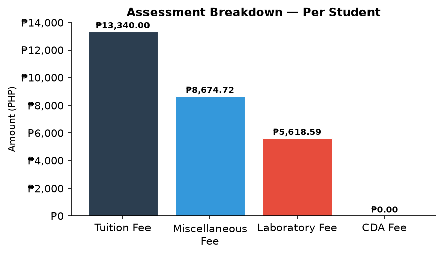

### Payment Schedule
Description: Four instalments and their payment status.

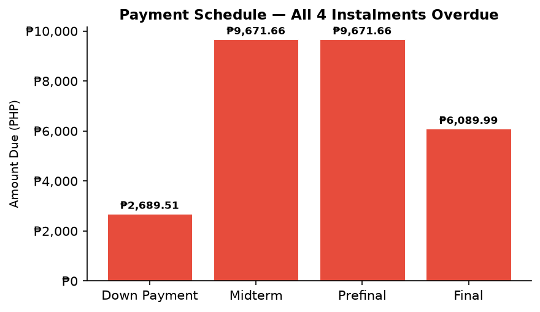

### Detector Performance
Description: GPU vs CPU inference latency and FPS.

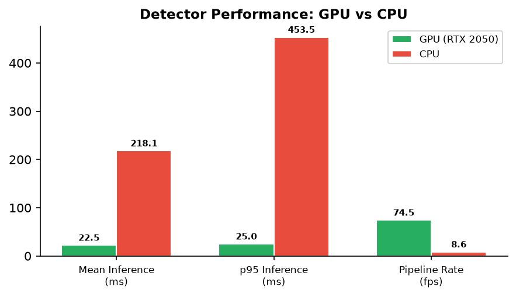

### Scan Success Rate
Description: 49 successful scans and 24 not-found scans (67.1%).

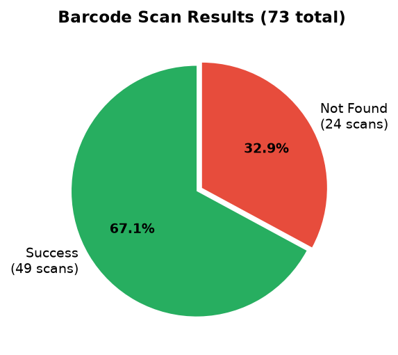

### Test Results
Description: 24 test modules and 557 passing tests.

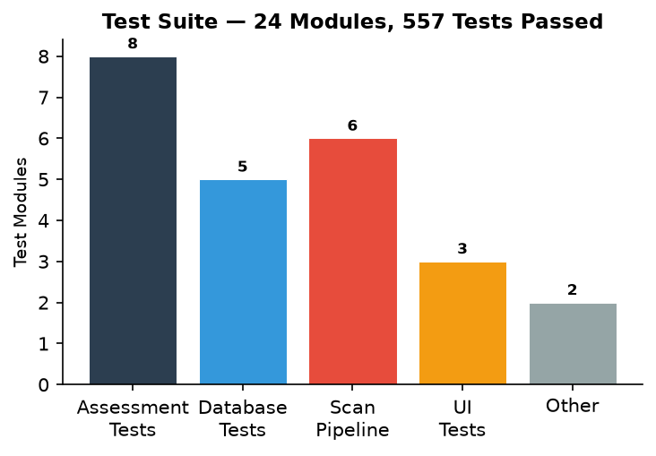

### Subject Credits
Description: Seven subjects and 20 total credits.

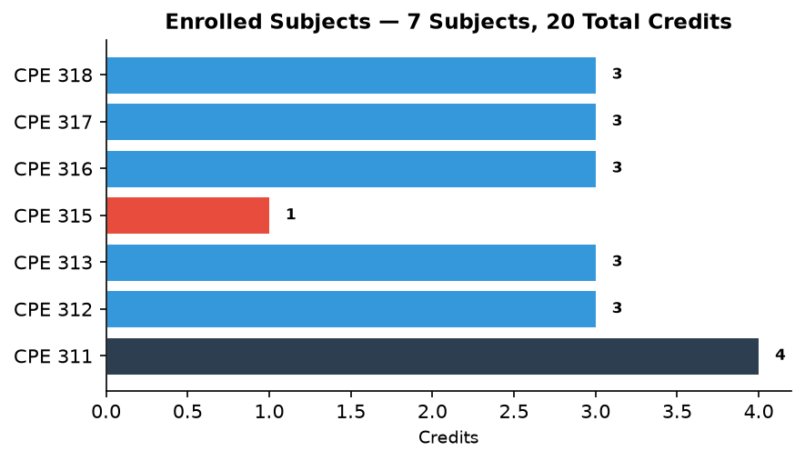

All charts are stored in `documentation/charts/`.

## Application Screenshots

Genuine screenshots captured from the live application:

### Dashboard
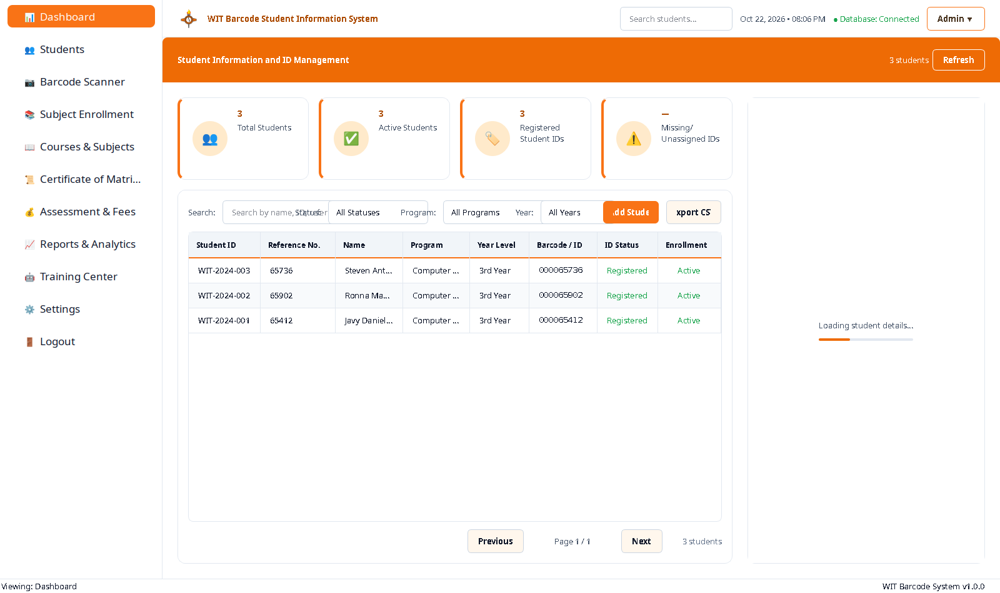

### Dashboard — Student Selected
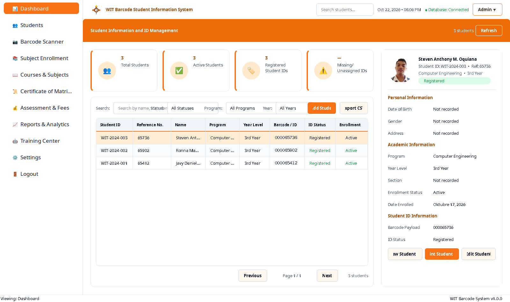

### Students Directory
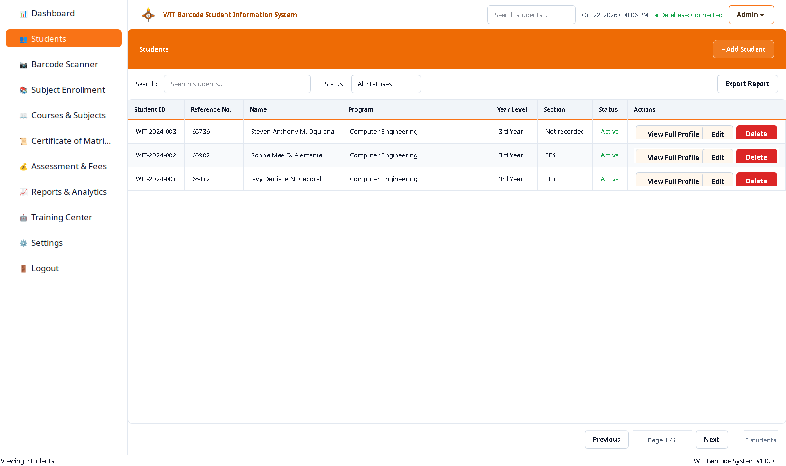

### Add Student Dialog
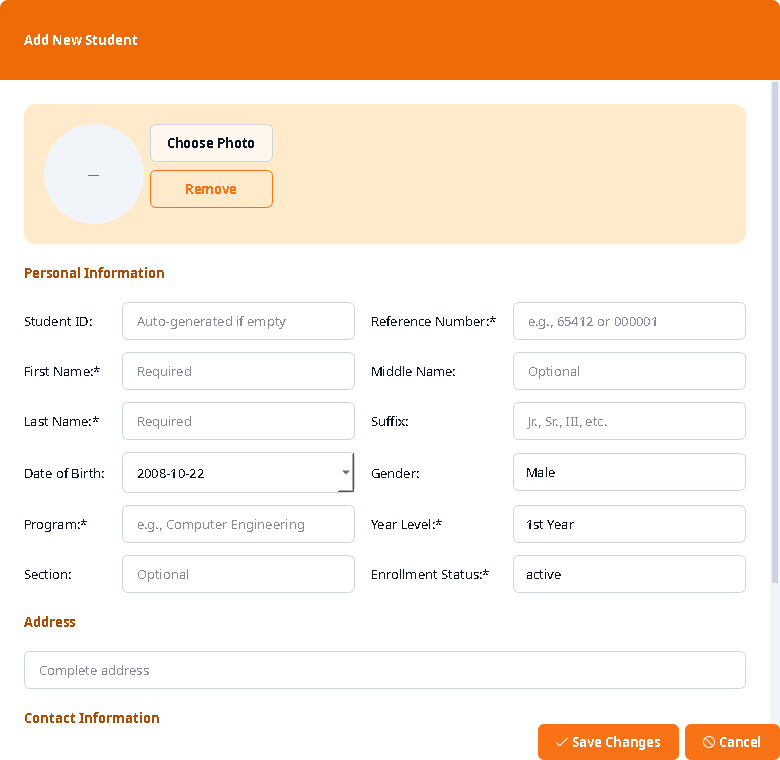

### Enrollment — Subjects
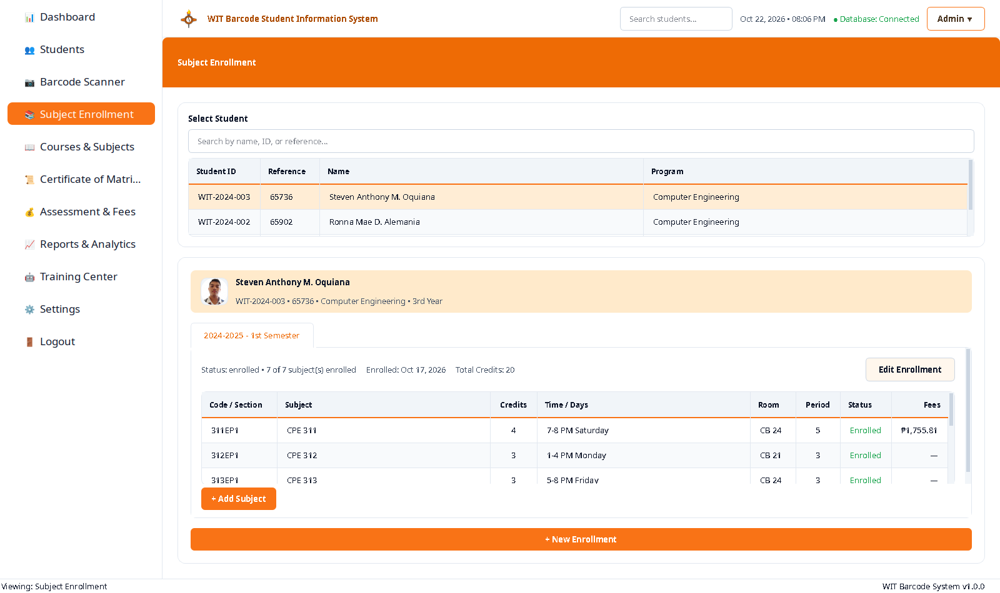

### Certificate of Matriculation
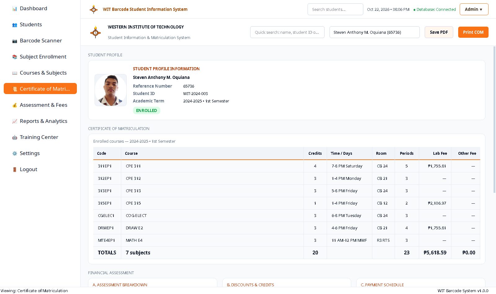

### Assessment and Fees
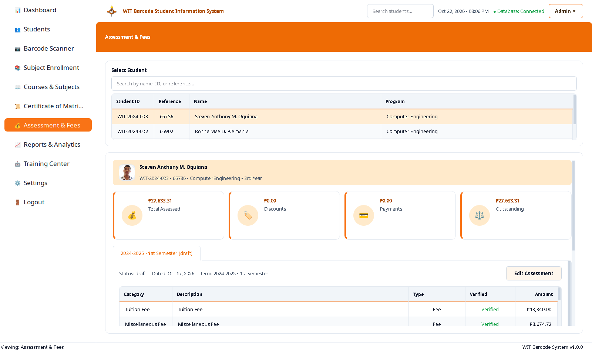

### Reports and Analytics
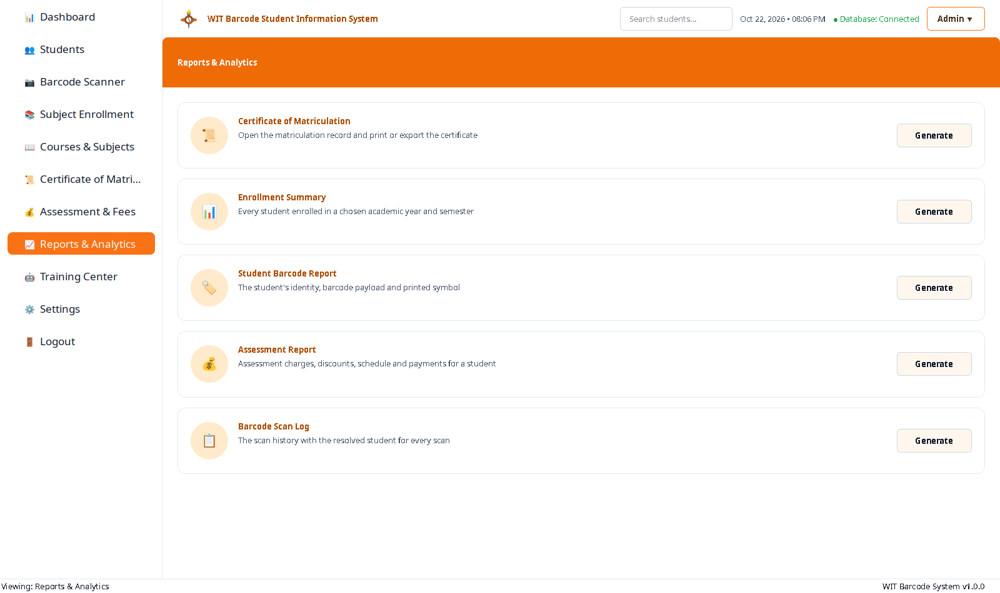

### Barcode Scanner — Verified
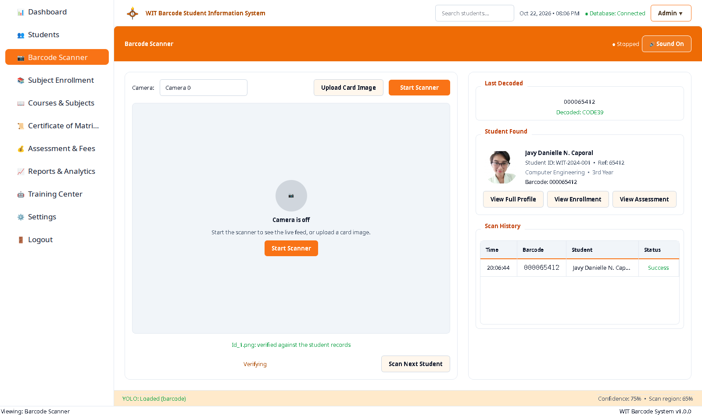

### Scan Result Panel
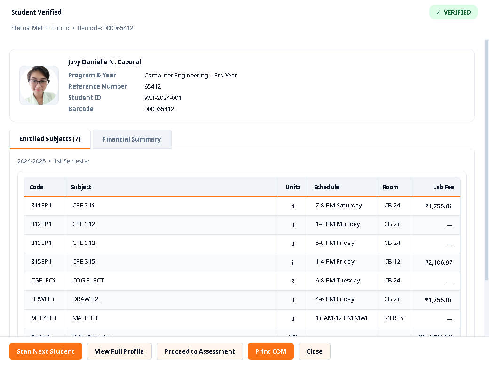

### Scanner — Live Camera
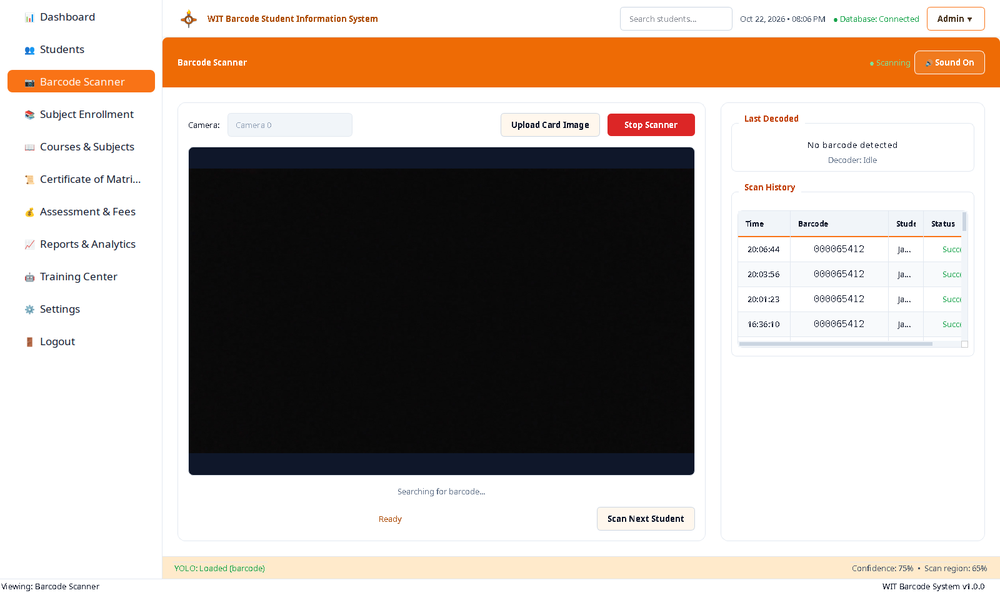

### Training Center
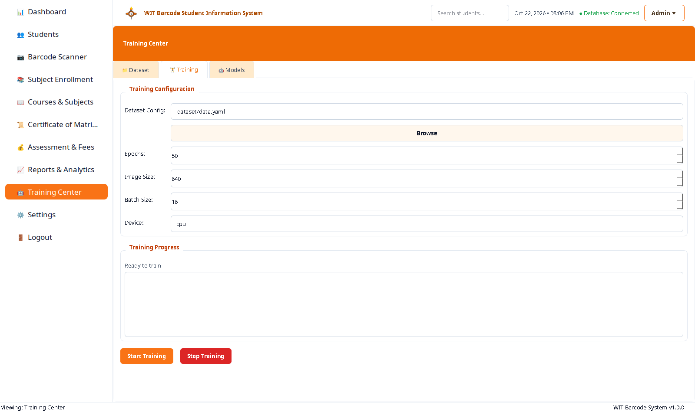

### Settings
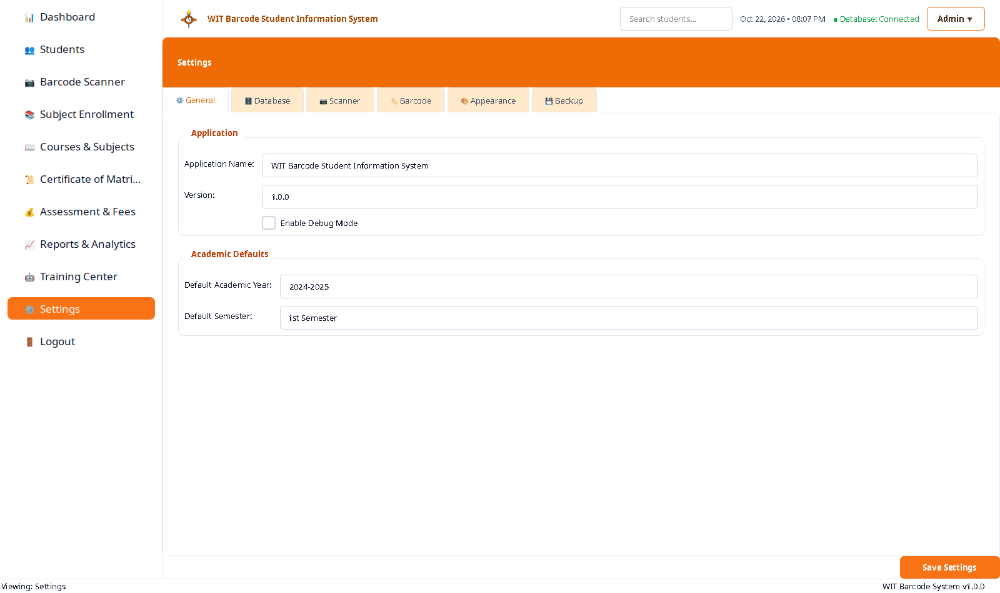

All screenshots are stored in `documentation/screenshots/`. See `documentation/screenshots/screenshot_manifest.txt` for the complete list of 23 captures.

## Developers and Contributors

Developed for Western Institute of Technology (WIT).

- **Tommy Paolma** — Developer
- **WIT IT Department**: For issues and feature requests

## License

Proprietary - Western Institute of Technology
