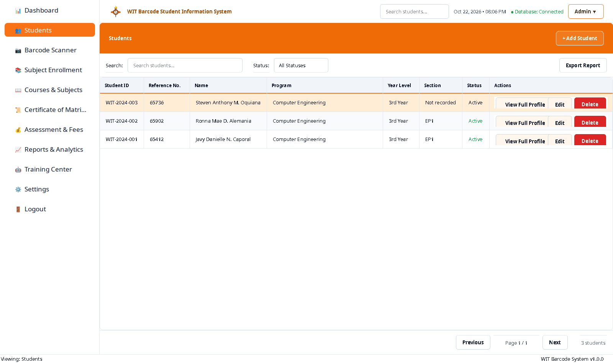
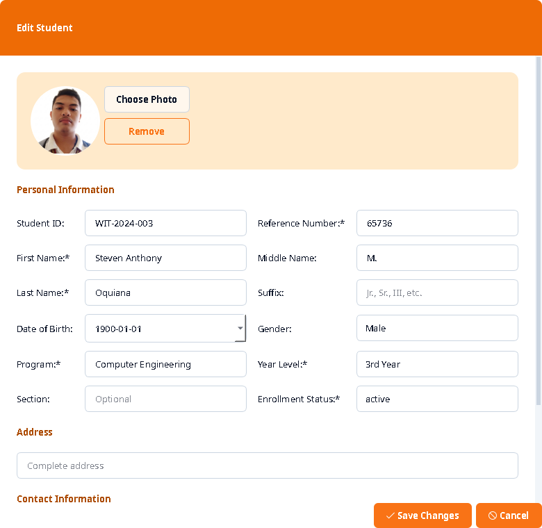
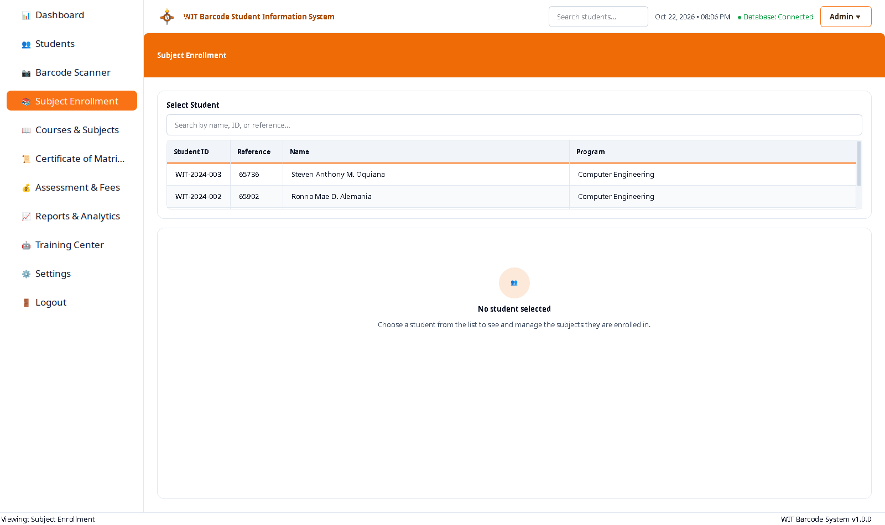
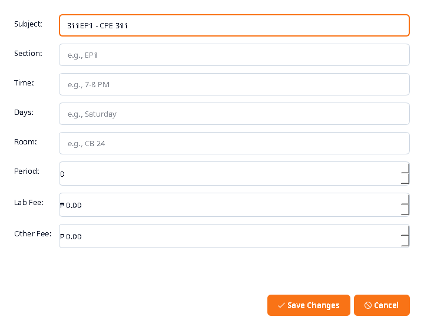
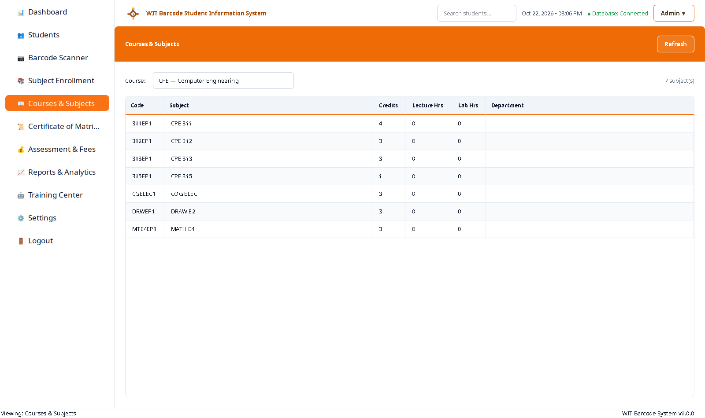
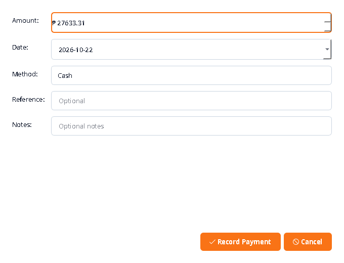
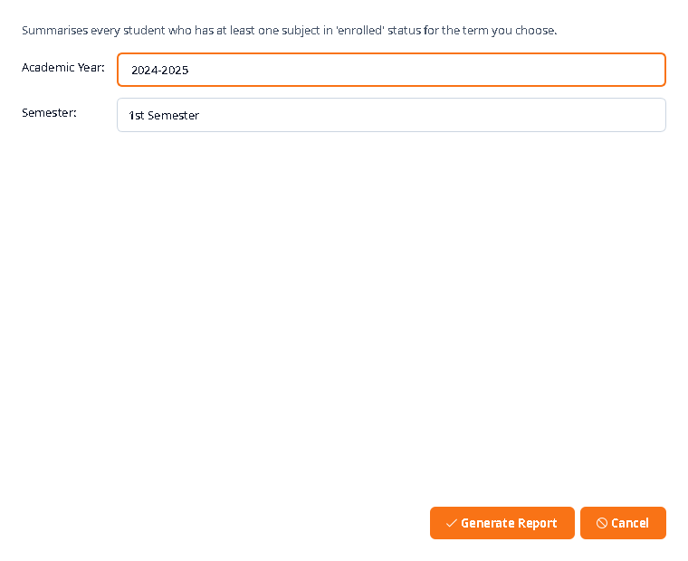
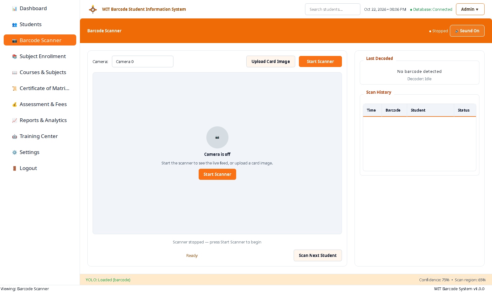
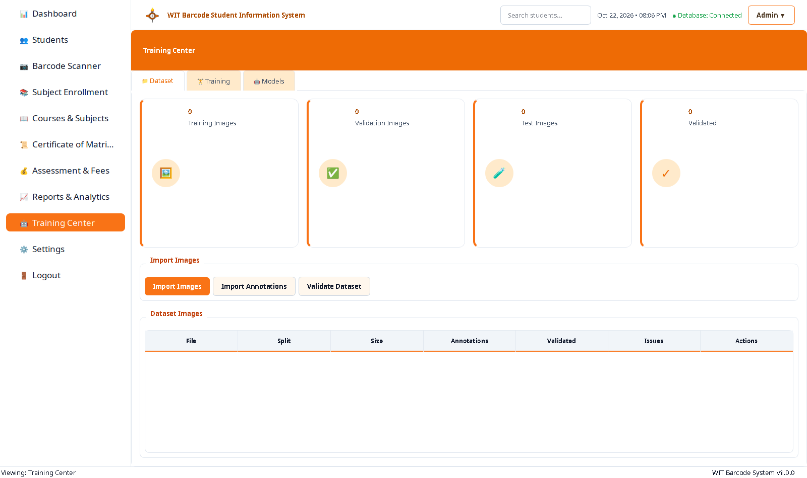
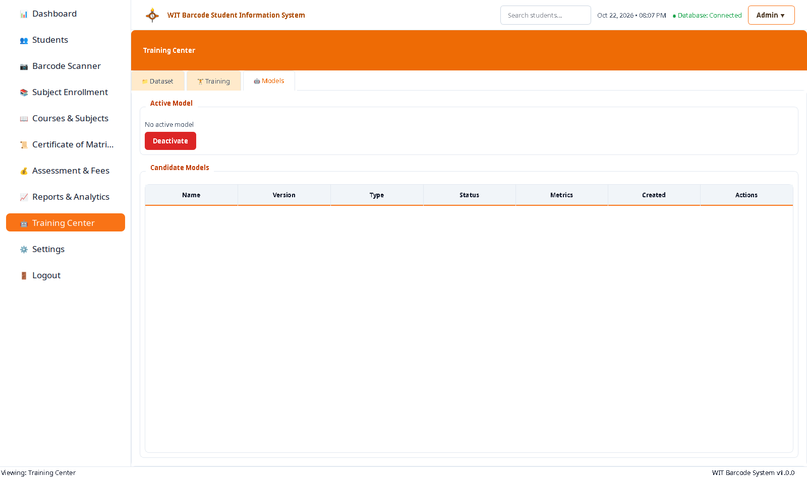

# WESTERN INSTITUTE OF TECHNOLOGY

## WIT Barcode Student Information System

### System Analysis, Design, and Implementation Documentation

---

**Project Title:** WIT Barcode Student Information System

**Document Type:** Academic Software Project Documentation (IMRaD)

**Application Name:** WIT Barcode Student Information System

**Application Version:** 1.0.0

**Institution:** Western Institute of Technology (WIT)

**Development Environment:** Ubuntu 26.04.1 LTS · Python 3.14.4 · PySide6 6.12.0 · MySQL 8.4.11 · YOLOv8n (Ultralytics 8.4.177) · NVIDIA GeForce RTX 2050

**Document Date:** 22 October 2026

---

### Document Control

| Item | Detail |
|---|---|
| Document title | WIT Barcode Student Information System — System Analysis, Design, and Implementation Documentation |
| Document version | 1.0 |
| Status | Final for review |
| Basis of evidence | Live application, live MySQL 8.4.11 instance, executed test suite, measured benchmark artefacts in `reports/` |
| Reproducibility | Every figure is generated by `scripts/capture_doc_screenshots.py` and `documentation/System_Diagrams/render_diagrams.py` |
| Word format | `documentation/Project_Documentation.docx` (A4, Times New Roman 12 pt, 1.5 spacing, justified, 1-inch margins) |
| PDF format | `documentation/Project_Documentation.pdf` |

### Revision History

| Version | Date | Author | Description of change |
|---|---|---|---|
| 0.1 | 2026-10-22 | Development Team | Initial analysis of requirements, schema, and module inventory |
| 0.9 | 2026-10-22 | Development Team | Screenshots captured from the running application; diagrams authored |
| 1.0 | 2026-10-22 | Development Team | IMRaD narrative completed; findings, limitations, and recommendations finalised |

### Statement of Authenticity

Every screenshot reproduced in Chapter III is a pixel capture of the running application against the live `wit_barcode_system` database. Every numerical figure quoted in this document was read from that database or from an artefact produced by an executed script; none has been estimated, extrapolated, or invented. Features that are present in the design but not implemented in the running build are explicitly marked **Proposed / Not implemented** and are never illustrated with a fabricated image. Section 4.5 lists every known defect, unresolved data discrepancy, and assumption on which this document relies.

---

## Table of Contents

> The table of contents below is a live Word field in `Project_Documentation.docx`. Press **Ctrl+A** then **F9** (Windows) or **Cmd+A** then **Fn+F9** (macOS) to refresh page numbers after editing. In this Markdown edition the contents list is written out statically and matches the Word document.

**Chapter I — Introduction** 1
1.1 Background of the Study 1
1.2 Statement of the Problem 1
1.3 Objectives of the Study 2
1.4 Significance of the Study 2
1.5 Scope and Delimitations of the Study 3
1.6 Conceptual Framework 3

**Chapter II — Methods** 5
2.1 Research Design and Development Methodology 5
2.2 Development Environment and Technology Stack 6
2.3 Requirements Analysis 7
2.4 Data Model Design 9
2.5 Architectural Design 11
2.6 Input–Process–Output Model 12
2.7 Use Case Analysis 13
2.8 Data Flow Analysis 14
2.9 Barcode Detection and Verification Method 15
2.10 Detector Training and Model Promotion Method 17
2.11 Verification and Validation Method 18
2.12 Screenshot and Figure Reproduction Method 19
2.13 Ethical and Data-Protection Considerations 20

**Chapter III — Results** 21
3.1 Overview of the Delivered System 21
3.2 Dashboard Module 22
3.3 Student Management Module 24
3.4 Subject Enrollment Module 26
3.5 Courses and Subjects Catalogue 28
3.6 Certificate of Matriculation Module 29
3.7 Assessment and Fees Module 31
3.8 Reports and Analytics Module 33
3.9 Barcode Scanner Module 34
3.10 Training Center 37
3.11 Settings and Configuration 38
3.12 Summary of Implemented and Proposed Features 39
3.13 Verification Results 40

**Chapter IV — Discussion** 42
4.1 Summary of Findings 42
4.2 Fulfilment of the Objectives 42
4.3 Discussion of the Scanner Pipeline 43
4.4 Limitations of the Study 44
4.5 Known Defects, Unresolved Data Discrepancies, and Assumptions 45
4.6 Implications of the Findings 47
4.7 Recommendations 47
4.8 Direction for Further Development 48

**References** 49
**Appendices** 51
Appendix A — Database Table Inventory
Appendix B — Configuration Parameters
Appendix C — Test Suite Inventory
Appendix D — Screenshot Manifest
Appendix E — File and Folder Manifest

---

# CHAPTER I
## INTRODUCTION

### 1.1 Background of the Study

Western Institute of Technology operates a registrar's office in which student identity is represented by a printed information panel carrying a Code 39 barcode. Historically the panel was verified by visual inspection: an officer compared the printed reference number on the panel against a record book, then transcribed the outcome into a second ledger. That workflow has three structural weaknesses. It is slow at the moment a queue forms, because each verification is serialised through one reader. It is untraceable, because the paper record of a verification is not queryable and cannot be joined to an assessment or a payment. And it is exposed to transcription error, because a reference number is copied by hand at least twice between the card and the ledger.

The WIT Barcode Student Information System was built to replace that workflow with a desktop application that (a) holds the authoritative student, enrolment, assessment, and payment records in a relational database, and (b) verifies a physical identification panel automatically by detecting the barcode on the printed panel, decoding it, and resolving the decoded payload to exactly one student row before any identity claim is presented to the operator.

The system is implemented as a PySide6 (Qt 6) desktop application backed by MySQL 8.4 through `mysql-connector-python` with hand-written SQL and no object-relational mapper. Barcode localisation is performed by a YOLOv8n detector fine-tuned from COCO-pretrained `yolov8n.pt` for a single class, `barcode`. Decoding is performed by a multi-strategy chain (`zxing-cpp` first, `pyzbar` as fallback, then a CODE39 module-width reconstruction pass) operating on a cropped region of interest. The training, evaluation, and promotion workflow for that detector is exposed inside the application itself through a Training Center page, so that the model lifecycle is reproducible by the laboratory staff rather than hidden in a shell history.

### 1.2 Statement of the Problem

The registrar's office is required to identify a student from a printed identification panel, confirm the enrolment and assessment state of that student, and issue a Certificate of Matriculation — quickly enough that a queue does not form, and with an auditable link between the card presented and the record retrieved. At the time of this study the environment offered the following specific problems.

1. **Manual identity verification.** A printed Code 39 symbol had to be read by eye and matched to a paper register. Verification throughput was bounded by reading speed and by the attention of a single officer.
2. **No single authoritative record.** Student master data, subject enrolment, assessment charges, and payment receipts were not held in one relational store with enforced referential integrity, so a composite document such as the Certificate of Matriculation could not be derived automatically and consistently.
3. **No machine-checkable link between card and record.** Because the reference number on the panel was transcribed rather than decoded, a mistyped digit produced a plausible-looking but wrong result, and nothing in the workflow distinguished a genuine match from a transcription error.
4. **No scan audit trail.** When a card was presented, the fact of the presentation was recorded only as a pencil mark. The system could not answer "which panels were read today, and what did each resolve to?"
5. **Detector development outside the tool.** The computer-vision model that performs localisation was produced by ad-hoc scripts. The evidence that justified promoting a candidate checkpoint to the active model was not reproducible from inside the operational application.

This study addressed the technical problem of building the tool that resolves problems 1 through 5, and it reports honestly on what remains open.

### 1.3 Objectives of the Study

The study was conducted to achieve the following objectives.

| ID | Objective |
|---|---|
| **O1** | To analyse the manual student-information and barcode-verification workflow of the registrar's office and identify the inefficiencies that an automated system must remove. |
| **O2** | To design a normalised relational database schema that supports student master data, subject enrolment, assessment charges, payment receipts, and barcode scan records under referential integrity. |
| **O3** | To implement a desktop application, using PySide6 and MySQL, that provides dashboard, student management, subject enrolment, catalogue, assessment, matriculation certificate, reporting, training, and settings modules over the schema of O2. |
| **O4** | To develop a barcode detection and verification pipeline — YOLOv8n localisation, geometric gating and cropping, multi-strategy CODE39 decoding, and exact relational lookup — that resolves a presented identification panel to a single verified student record. |
| **O5** | To implement the detector training, evaluation, and promotion lifecycle inside the application so that a candidate model replaces the active checkpoint only on measured evidence. |
| **O6** | To verify the delivered system's functional correctness with an executed automated test suite, and to verify the scanner against the real identification panels held by the institute. |
| **O7** | To document the system with context, input–process–output, architectural, entity–relationship, use case, and data flow models, and with a per-module figure catalogue that records the description, functionality, process, output, and contribution of every page and dialog. |
| **O8** | To identify and report the limitations of the delivered system, the unresolved data discrepancies still present in the production data, and the assumptions on which the reported findings depend. |

### 1.4 Significance of the Study

The study is significant in four respects.

**For the registrar's office.** The system removes the re-keying step between the card and the record. A decoded payload is compared against the database by exact string match, so the identity presented on screen is the identity stored in the database and not a human transcription of it. The Certificate of Matriculation and the assessment statement are then computed from the same rows that produced the identity, so the document and the record cannot disagree.

**For the laboratory.** The detector training recipe, the promotion gate, and the benchmark procedure are consolidated into scripts and surfaced in the application. The detection threshold of 0.75 and the inference size of 640 px recorded in this document are the outcome of measurement over real frames, not of preference, and the measurements are retained as artefacts under `reports/`.

**For future maintenance.** The schema, the service layer, and the UI layer are separated, so a change to the pipeline does not require a change to the database, and a change to the schema does not require a change to the widgets. The automated test suite gives a regression baseline.

**For academic documentation.** The models presented in Chapter II and the figure catalogue in Chapter III give a reader an accurate, evidence-backed account of what exists, what it does, and what it does not do — including the parts that are proposed rather than delivered.

### 1.5 Scope and Delimitations of the Study

**Scope.** The study covers the desktop application source tree, the MySQL schema and its seeded production-shaped data, the service layer that performs detection, decoding, lookup, and document rendering, the PySide6 user interface, the detector training and promotion tooling, and the automated test suite. It covers ten routed pages (Dashboard, Students, Subject Enrollment, Courses & Subjects, Certificate of Matriculation, Assessment & Fees, Reports & Analytics, Barcode Scanner, Training Center, Settings), four dialogs, and a fifth page module (`BarcodeGeneratorPage`) that is implemented but is not reachable from the sidebar.

**Delimitations.** The following are outside the scope of this study and are therefore not claimed as delivered.

- **Authentication and role-based access control.** No sign-in exists. The application writes and reads every row under a single configured database account, and the `users` table is empty in the production-shaped dataset. Multi-user concurrency control, per-user audit attribution, and privilege separation are proposed, not implemented (see Section 3.12 and Figure 31).
- **Logout.** The sidebar's Logout entry currently reports that logout functionality is to be implemented.
- **Multi-campus, multi-tenant operation.** The schema and configuration are single-institution.
- **Network deployment.** The application is a locally installed desktop program. A hosted or thin-client deployment is not evaluated.
- **Independent accuracy validation.** No third-party or institutional accuracy audit was available to this study. All detector figures quoted are from the project's own measured artefacts.
- **Hardware procurement and camera calibration procedures.** The study used the workstation's built-in webcam at index 0; no industrial fixed-mount or VFS-UVC reader was evaluated.

### 1.6 Conceptual Framework

The conceptual framework of the study is presented in Figure 1. The system is positioned as the mediating artefact between four human actor groups and five external systems. The registrar's officer enters and corrects student, enrolment, and assessment data; the cashier records payments and issues the matriculation certificate; the administrator configures the application and trains or promotes the detector; and laboratory or technical staff maintain the dataset and run the verification scripts. The system reads and writes the MySQL server, captures frames from a USB or built-in webcam, loads and applies the YOLOv8n detector, invokes the ZBar and zxing-cpp decoders, and exports documents to a printer or PDF viewer.

**Figure 1. System context diagram of the WIT Barcode Student Information System.**

*Source: authored for this study in Mermaid (`documentation/System_Diagrams/01_system_context.mmd`); rendered with `documentation/System_Diagrams/render_diagrams.py`. The actor and component names correspond to the modules described in Sections 2.2 and 3.2–3.11.*

---

# CHAPTER II
## METHODS

### 2.1 Research Design and Development Methodology

The study followed a **developmental research design** combined with **iterative prototyping**. In a developmental design, the artefact is the primary unit of analysis: the system is constructed incrementally, and the literature of the domain is used to justify design decisions rather than to be tested. Iterative prototyping was used within that design because the requirements of a registrar's office could not be completely specified before an operator could see and comment on a running build.

The methodology comprised six phases executed in the order given.

**Phase 1 — Requirements elicitation and workflow analysis.** The existing manual workflow was reconstructed from the institute's paper artefacts (printed information panels, the assessment sheet, the reference-number register) and from walkthrough observation of the registrar's office. The artefacts produced were the functional requirement list (Section 2.3) and the context diagram (Figure 1).

**Phase 2 — Data model design.** The entities that the office actually manipulates — student, contact, course, subject, enrolment, enrolment-subject, barcode, scan, assessment, assessment-item, payment, payment-schedule, ID card, model, dataset image, audit log, system setting, user — were normalised and implemented as 19 MySQL tables with declared foreign keys, unique constraints, and enumerated status columns. The result is presented in Section 2.4 and Figure 5.

**Phase 3 — Architectural design.** A three-tier, strictly one-directional-dependency architecture was adopted: presentation (Qt widgets) → services (pure Python logic) → data access (`database/connection.py`, `database/schema.py`, raw SQL). No widget writes SQL and no service imports a widget. The architecture is presented in Section 2.5 and Figure 3.

**Phase 4 — Implementation.** The GUI was built on PySide6 6.12.0 with a shared stylesheet (`ui/styles/`), a common top bar and status bar, and a sidebar router in `ui/main_window.py` that instantiates each page lazily from the `PAGE_CLASSES` registry. The detection and decoding pipeline was implemented in `services/` and exercised by the scanner page.

**Phase 5 — Detector development.** A YOLOv8n model was fine-tuned from COCO-pretrained weights on a distance-and-angle corpus built from the institute's own printed panels. Because a model is only useful if it can be promoted on evidence, a promotion gate was written into `scripts/train_yolo.py` such that a candidate checkpoint replaces `models_yolo/active/best.pt` only if it produces zero false positives on barcode-free documents and does not lose held-out decode rate against the incumbent. The procedure is described in Section 2.10 and Figure 8.

**Phase 6 — Verification, documentation, and reporting.** The system was verified by an executed automated test suite and by measurement artefacts; the documentation in Chapters II and III was produced from the running build, and the residual defects were recorded rather than concealed.

### 2.2 Development Environment and Technology Stack

The system was developed and verified on the environment given in Table 1. Every version listed was read from the live interpreter (`pip list`), the live database server (`SELECT VERSION()`), or the operating system, at the time of capture — none is an assumed or recommended version.

**Table 1. Development and verification environment.**

| Layer | Component | Version / specification | Role in the system |
|---|---|---|---|
| Operating system | Ubuntu | 26.04.1 LTS | Host workstation, desktop session on X.Org 24.1.10 |
| Language runtime | CPython | 3.14.4 | Application runtime |
| GUI toolkit | PySide6 (Qt 6) | 6.12.0 | All windows, widgets, dialogs, threading |
| Database server | MySQL | 8.4.11 | Authoritative relational store, schema `wit_barcode_system` |
| Database driver | mysql-connector-python | 26.7.0 | Raw SQL access; connection pool of 10 |
| Deep learning framework | PyTorch | 2.14.1 | Inference backend for the detector (CUDA) |
| Vision framework | torchvision | 0.29.1 | Dataset and augmentation pipeline for training |
| Detector framework | Ultralytics | 8.4.177 | YOLOv8n training, validation, and inference API |
| Image processing | OpenCV (opencv-python) | 5.0.0.93 | Frame capture, preprocessing, geometric transforms |
| Numerical computing | NumPy | 2.5.4 | Array arithmetic on frames, crops, and boxes |
| Imaging library | Pillow | 12.3.0 | Card and panel image handling, perceptual hashing |
| Perceptual hashing | imagehash | 4.3.2 | Duplicate / near-duplicate detection of panel images |
| Barcode generation | python-barcode | 0.16.1 | Rendering CODE39 symbols for card and panel output |
| Barcode decoding | zxing-cpp | 3.1.1 | Primary decoder (primary decode attempt) |
| Barcode decoding | pyzbar (ZBar) | 0.1.9 | Secondary decoder, and label source for ground truth |
| Document generation | ReportLab | 5.0.1 | A4 PDF export of the Certificate of Matriculation |
| Plotting | matplotlib | 3.11.2 | Report charts and dataset plots |
| Configuration | python-dotenv | 1.2.4 | Loads `.env` into the process environment |
| Test framework | pytest | 9.1.1 | Automated test execution |
| GUI test support | pytest-qt | 4.5.0 | `qtbot` fixtures for widget and dialog tests |
| Mocking support | pytest-mock | 3.16.0 | Isolation of database and detector dependencies |
| Accelerator | NVIDIA GeForce RTX 2050 | 4 GB, compute capability 8.6 | GPU inference (9.82× faster than CPU, see Section 2.9) |
| Camera | Built-in / USB webcam at index 0 | 1280 × 720 @ 30 fps | Live frame source for the scanner page |

### 2.3 Requirements Analysis

Requirements were derived from the workflow analysis and are recorded here in the form in which they constrain the implementation.

#### 2.3.1 Functional requirements

**Table 2. Functional requirements and the module that satisfies them.**

| ID | Requirement | Satisfying module |
|---|---|---|
| FR-01 | The system shall display aggregate student counts, a searchable and filterable student table, and a detail panel for the selected student. | Dashboard (`ui/dashboard.py`) |
| FR-02 | The system shall register a student with name, reference number, programme, year level, section, enrolment status, contact information, and an optional photograph. | Students (`ui/students_page.py`, `ui/dialogs/student_dialog.py`) |
| FR-03 | The system shall edit and delete an existing student record and shall export the directory to CSV. | Students |
| FR-04 | The system shall associate a nine-digit zero-padded CODE39 payload with each student and shall expose the payload and its registration status. | Students, Dashboard, `services/identifiers.py` |
| FR-05 | The system shall create an enrolment for a student against an academic term and semester, and shall attach subjects with section, schedule, room, period, and fee attributes. | Subject Enrollment (`ui/enrollment_page.py`) |
| FR-06 | The system shall maintain a catalogue of courses and subjects with credits, lecture hours, laboratory hours, and department. | Courses & Subjects (`ui/courses_page.py`) |
| FR-07 | The system shall compose a Certificate of Matriculation showing the student profile, the enrolled course list, the assessment breakdown, discounts, and the payment schedule, and shall export it as PDF or send it to a printer. | Certificate (`ui/certificate_page.py`, `services/com_document.py`, `services/com_print_service.py`) |
| FR-08 | The system shall record assessment charges by category, discounts and credits, and a schedule of instalments with due dates and status. | Assessment & Fees (`ui/assessment_page.py`, `services/assessment_service.py`) |
| FR-09 | The system shall record a payment against an assessment with amount, date, method, reference, and notes, and shall reduce the outstanding balance. | Assessment & Fees, Record Payment dialog |
| FR-10 | The system shall generate the five operational reports: Certificate of Matriculation, Enrollment Summary, Student Barcode Report, Assessment Report, and Barcode Scan Log. | Reports & Analytics (`ui/reports_page.py`, `services/report_service.py`) |
| FR-11 | The system shall acquire frames from a camera or from an uploaded card image, detect the barcode, decode it, and resolve it to exactly one student record before presenting any identity. | Barcode Scanner (`ui/scanner_page.py`, `services/scan_pipeline.py`) |
| FR-12 | The system shall present the scan state to the operator in the vocabulary SEARCHING, BARCODE_DETECTED, DECODING, VERIFIED, UNKNOWN_BARCODE, AMBIGUOUS, and ERROR. | Scanner, `services/scan_pipeline.py` |
| FR-13 | The system shall append every scan attempt to a persistent history with time, payload, resolved student, and status, and shall display that history in the scanner. | Scanner, `barcode_scans` table |
| FR-14 | The system shall play an audible success cue only after a payload has been decoded **and** matched to a database row. | Scanner, `services/audio_cue.py` |
| FR-15 | The system shall present the verified identity together with the student's enrolled subjects and fee position in a structured scan-result panel. | Scan Result dialog (`ui/dialogs/scan_result_dialog.py`) |
| FR-16 | The system shall import, validate, and describe a training dataset within the application, and shall report per-split counts and per-image validation issues. | Training Center (`ui/training_center.py`) |
| FR-17 | The system shall train a detector from the application with configurable epochs, image size, batch size, and device, and shall report progress and the resulting metrics. | Training Center, `scripts/train_yolo.py` |
| FR-18 | The system shall maintain a registry of trained models with version, type, status, and metrics, and shall activate or deactivate a registered model. | Training Center, `yolo_models` table |
| FR-19 | The system shall expose application identity, version, default academic year and semester, and the detector and camera configuration, and shall persist changes to `system_settings`. | Settings (`ui/settings_page.py`) |
| FR-20 | The system shall write an entry to the audit log for every consequential change to student mapping. | `audit_logs` table, `scripts/resolve_student_mapping.py` |

#### 2.3.2 Non-functional requirements

**Table 3. Non-functional requirements and the basis of each.**

| ID | Requirement | Basis / measurement |
|---|---|---|
| NFR-01 | The scanner shall keep the live preview responsive on the target workstation. | Measured 74.46 fps with CUDA versus 8.59 fps on CPU for the same model and frames (`reports/device_benchmark.json`). |
| NFR-02 | The detector shall not raise a false detection on a document that contains no barcode. | The promotion gate requires zero false positives on barcode-free frames; on 15 barcode-free frames the highest false box scored 0.606, and the active threshold of 0.75 sits above it. |
| NFR-03 | A decoded payload shall resolve to at most one student; ambiguity shall be surfaced, not silently resolved. | Enforced in `services/identifiers.py` and surfaced as the AMBIGUOUS state (Figure 4). |
| NFR-04 | The application shall remain usable if the database becomes unavailable. | `database/connection.py` raises `DatabaseUnavailableError`, caught by `ui/db_error.py`, which renders a recoverable error state instead of a crash. |
| NFR-05 | Database credentials and tuning shall be externalised from source. | All tunables are read from `.env` through `python-dotenv` into `config/settings.py`. |
| NFR-06 | The detector shall run on a CPU-only workstation without code change. | `services/yolo_detector.py` falls back to CPU automatically when the GPU is unavailable. |
| NFR-07 | The data model shall enforce referential integrity. | Foreign keys are declared on the 19 tables in `database/schema.py`. |
| NFR-08 | Consequential changes shall be auditable. | `audit_logs` records the old and new value of a changed field. |
| NFR-09 | The application shall present a consistent visual language. | A shared stylesheet in `ui/styles/` is applied across all pages. |
| NFR-10 | Document output shall be A4 and reproducible. | Certificate export is generated by ReportLab at fixed A4 geometry. |
| NFR-11 | The system shall be verifiable by an automated test suite. | 557 tests executed and passed (Section 2.11). |

### 2.4 Data Model Design

The data model was derived from the noun inventory of the registrar's paperwork and then normalised. Nineteen tables were created in `database/schema.py` and applied to the MySQL 8.4.11 server. The complete inventory is reproduced in Appendix A; the entity–relationship model is presented in Figure 5.

The design decisions that mattered were as follows.

**Reference number versus barcode payload.** A student's *reference number* is the human-facing identifier printed on the information panel (for example `65412`); the *barcode payload* is the nine-digit zero-padded string encoded in the CODE39 symbol (`000065412`). The mapping is deterministic and is implemented in `services/identifiers.py` as `padded_payload()` and `reference_from_payload()`. A small, explicit alias table, `REFERENCE_ALIASES = {"000001": "65902"}`, records the one printed panel whose payload does not follow the zero-padding rule; it is consulted by `resolve_reference()` before the standard rule is applied. This keeps the exceptional case visible in one place instead of spreading it across the codebase.

**Scan records are first-class.** The `barcode_scans` table stores every attempt — including attempts that did not resolve — with time, payload, resolved student, status, and the raw decoder output. This is what makes FR-13 and the Barcode Scan Log report possible, and it is also the evidence base for the AMBIGUOUS and UNKNOWN_BARCODE states.

**Assessment is separated from its lines.** `assessments` holds the header (student, enrolment, term, semester, status, date, and the four stored totals `total_assessed`, `total_discounts`, `total_payments`, `outstanding_balance`); `assessment_items` holds one row per charge with a category, description, type, amount, and a verification flag; `payment_schedules` holds the instalment plan; `payments` holds receipts. The Certificate of Matriculation is therefore a *view* over these rows, never a second stored copy of a document.

**Stored totals are re-derived, not trusted.** `services/com_summary.py` recomputes the fee-item total and the discount total from the `assessment_items` rows and compares them with the header values stored on `assessments`; the sum of the `payment_schedules` rows is computed independently and compared with the assessed total and with the outstanding balance. The function `summarize_financials()` returns the assessment together with a list of *discrepancies*, and `ui/certificate_page.py` renders that list as the "Unresolved totals" notice. No figure is adjusted to make a sheet balance.

**Consequence of that design.** Because three totals are derived independently and compared, a disagreement between them is *detectable*. This turned out to matter in practice: the production-shaped data currently exhibits exactly such a disagreement of ₱489.51, which the application surfaces explicitly rather than absorbing (Figure 19, Section 4.5).

**Figure 5. Entity–relationship diagram of the `wit_barcode_system` schema.**

*Source: authored from `database/schema.py` in Mermaid (`documentation/System_Diagrams/05_entity_relationship_diagram.mmd`). Solid lines denote foreign-key relationships; the barcoded relationships are those recorded in `database/schema.py`.*

### 2.5 Architectural Design

The application uses a **layered (three-tier) architecture** with strictly one-directional dependencies.

**Figure 3. Layered architecture of the WIT Barcode Student Information System.**

*Source: authored for this study in Mermaid (`documentation/System_Diagrams/03_system_architecture.mmd`). The diagram is presented on a landscape page in the Word edition so that its width is not reduced to fit a portrait text block.*

The layers and their responsibilities are:

**Presentation layer (`ui/`).** Qt widgets, pages, and dialogs. Each page class exposes a `PAGE_CLASSES`-registered class that the router in `ui/main_window.py` instantiates on first navigation. Pages may request a student record but are handed an identifier, not a trusted object: `preload_student` re-reads the record from the database before display, so a stale in-memory object cannot become the source of truth. Pages emit navigation requests; they do not call each other.

**Service layer (`services/`).** Pure-Python logic with no Qt dependency in the modules that are reused outside the GUI: `identifiers` (reference/payload rules), `barcode_decoder` (multi-strategy decode), `code39_recovery` (module-width reconstruction), `scan_pipeline` (state machine), `scan_geometry` (gate and crop maths), `scan_session` (duplicate latching), `detection_smoother` (box stabilisation), `yolo_detector` (model loading and inference), `assessment_service`, `student_service`, `com_summary` (arithmetic and discrepancy detection), `com_document`, `com_print_service`, `report_service`, `id_card_service`, `camera_service`, `audio_cue`, `scanner_overlay`. Because this layer is Qt-free, the pipeline can be exercised head-lessly, which is exactly how the test suite drives it.

**Data access layer (`database/`).** `database/connection.py` owns a `mysql.connector` connection pool of ten, reads credentials from `config/settings.py`, and raises `DatabaseUnavailableError` on failure. `database/schema.py` owns the DDL and the idempotent schema application.

**Configuration (`config/`).** `config/settings.py` reads `.env` and exposes typed constants; no module reads an environment variable directly.

**Models (`models/`).** Light dataclass-like value objects (`student.py`, `enrollment.py`, `assessment.py`, `barcode.py`, `id_card.py`, `yolo.py`) that carry rows between the data and service layers.

The architectural payoff is testability: the suite can substitute a fake database or a fake detector at the service boundary without constructing a widget tree.

### 2.6 Input–Process–Output Model

Figure 2 expresses the system as a transformation of eight input classes into seven output classes, through seven processing stages.

**Figure 2. Input–Process–Output model of the WIT Barcode Student Information System.**

*Source: authored for this study in Mermaid (`documentation/System_Diagrams/02_ipo_model.mmd`).*

Two properties of this model are worth stating explicitly because they constrain the rest of the design.

**The identity path is short and is a join, not a lookup by guesswork.** Camera frame (I7) → preprocessing (P1) → detection (P2) → decode (P3) → SQL lookup (P4) → verified identity (O1). The lookup is an exact match on the stored payload; there is no fuzzy matching, no name inference, and no "closest candidate" behaviour anywhere in the resolution path.

**The document path is a projection of stored rows.** Enrolment (I3), assessment (I4), and payment (I5) feed the aggregate and render stages (P5, P6), which produce the Certificate of Matriculation (O3), assessment and payment statements (O4), enrolment and barcode reports (O5), and the printed ID card (O6). Nothing on a printed document is transcribed by hand; every value is read from the row that produced it.

### 2.7 Use Case Analysis

Figure 6 identifies the actors, the use cases, and the relationships between them.

**Figure 6. Use case diagram of the WIT Barcode Student Information System.**

*Source: authored for this study in Mermaid (`documentation/System_Diagrams/06_use_case_diagram.mmd`). The actor set matches the four actor groups in Figure 1.*

The use case diagram exposes a deliberate omission. There is no "sign in", "log in", or "authenticate" use case, because the application has no authentication mechanism (Section 1.5). Every actor in Figure 6 therefore reaches every use case, which is an honest representation of the delivered system rather than an aspiration.

### 2.8 Data Flow Analysis

The level-0 data flow of Figure 7 shows how data crosses the system boundary.

**Figure 7. Level-0 data flow diagram of the WIT Barcode Student Information System.**

*Source: authored for this study in Mermaid (`documentation/System_Diagrams/07_data_flow_diagram.mmd`).*

Two flows are distinct in Figure 7 and are worth naming because they are often conflated in descriptions of this class of system.

**Flow 1 — the card-to-record flow.** A physical panel enters the system as an image, not as a database row. It is transformed (image → detected region → decoded string) and then it *terminates* at a relational row: the flow's output is a row reference, not a new row of student data. The scanned panel does not create, modify, or enrich the student record. It identifies one.

**Flow 2 — the record-to-document flow.** Rows flow out of the database and are aggregated into documents. This flow is read-only with respect to `students`, `enrollments`, and `assessment_items`, but it is not read-only with respect to `payments`: recording a payment writes a row that immediately changes the outstanding balance on every subsequent document.

**Table 4. Principal data stores and their flows.**

| Data store | Populated by | Read by | Notes |
|---|---|---|---|
| `students`, `student_contacts` | Student dialog, import script | Dashboard, Students, Enrollment, Certificate, Assessment, Reports, Scanner | Master data; reference number is unique |
| `courses`, `subjects` | Courses & Subjects page | Enrollment, Certificate, Assessment | Catalogue |
| `enrollments`, `enrollment_subjects` | Subject Enrollment page | Certificate, Assessment, Reports, Scanner result | Carries term, semester, credits, fees |
| `barcodes` | Barcode generator service | Students, Barcode report | Payload ↔ student binding |
| `barcode_scans` | Scanner pipeline | Scanner history, Scan Log report | Append-only; includes failures |
| `assessments`, `assessment_items`, `payment_schedules`, `payments` | Assessment page, Record Payment dialog | Certificate, Assessment, Reports | Totals computed, not stored |
| `yolo_models`, `dataset_images` | Training Center | Training Center, Settings | Model registry and dataset description |
| `audit_logs`, `system_settings` | Mapping resolution script, Settings page | Audit surfaces | Administrative trail |

### 2.9 Barcode Detection and Verification Method

The detection and verification method is the technical core of the system and is described in full in Figure 4.

**Figure 4. Flowchart of the live barcode scanning and verification pipeline.**

*Source: authored for this study in Mermaid (`documentation/System_Diagrams/04_scan_pipeline_flowchart.mmd`), from the implemented behaviour of `services/scan_pipeline.py`, `services/scan_geometry.py`, `services/barcode_decoder.py`, and `services/code39_recovery.py`. The diagram is presented on a landscape page in the Word edition.*

The method, in the order the pipeline applies it, is as follows.

**Step 1 — Acquisition and preprocessing.** A frame is acquired either from the camera (1280 × 720) or from an uploaded card image. The frame is letterboxed to the detector's 640 × 640 input and colour-normalised. The detector's input size of 640 was chosen from measurement rather than by convention: the detector cannot represent a box wider than 32 cells of its output grid, and at 1280 a symbol filling more than roughly 80 % of the frame width is unrepresentable, whereas at 640 detection was 100 % across the whole distance and angle sweep, with IoU between 0.83 and 0.94 and no false positives.

**Step 2 — Detection.** YOLOv8n runs at a confidence threshold of 0.75 and an NMS IoU of 0.45. The threshold of 0.75 was raised from 0.35 on 15 October 2026 on the basis of measurement: across 15 barcode-free frames the highest false box scored 0.606, while on a held-out card the lowest true box scored 0.897. The threshold therefore sits inside a measured gap — above every false positive and below every true positive. The code comments in `.env` record this reasoning and warn that 0.75 is the top of a safe band rather than a precise boundary.

**Step 3 — Geometric gating.** A detected box is accepted for decoding only if it lies within the operator's scan region and the crop it would yield is at least 80 × 24 pixels. The scan region is 66 % of the frame width by 42 % of the frame height; the gate ratios are 0.88 by 0.88. A box that fails the gate produces the BARCODE_DETECTED state with the instruction "move the card further into frame" rather than a decode attempt on a region too small to read.

**Step 4 — Cropping.** An accepted box is cropped with a 30 % margin so that the quiet zone of the CODE39 symbol is included — the margin is what makes the symbol decodable rather than merely detectable.

**Step 5 — Multi-strategy decoding.** The crop is decoded under a cascade of transforms: the original, greyscale, 2×, 3× and 4× upscales, unsharp masking, Otsu binarisation, CLAHE, adaptive thresholding, denoising, and rotation. `zxing-cpp` is attempted first and `pyzbar` second. If both fail, a CODE39 *reconstruction* pass is invoked: the crop is binarised and the symbol's bar widths are estimated, and a payload is rebuilt by voting over the module-width sequence using the CODE39 character table. This last stage exists because the detector can localise a symbol that is blurred, partially occluded, or too small for a generic decoder, while the bar structure remains recoverable.

**Step 6 — Exact relational lookup.** The decoded string is normalised by `services/identifiers.py` — zero-padded to nine digits, or mapped through the alias table — and then matched by **exact string equality** against the stored payload. There is no partial matching, no edit-distance fallback, and no ranking of near candidates. If no row matches, the state is UNKNOWN_BARCODE. If two different payloads are decoded from a single frame, the state is AMBIGUOUS and the operator is asked to present a single card.

**Step 7 — Session latching.** A successful payload is latched for the current session. The latch is released only when the card leaves the frame, which prevents a single physical presentation from being counted repeatedly as the camera continues to see the card. Duplicate suppression is additionally governed by a five-second cooldown and a configurable confirm-frame count.

**Step 8 — Persistence and feedback.** The attempt is appended to the on-screen scan history and persisted to `barcode_scans`. Only after both a decode **and** a database match does the system play the audible success cue. The structured Scan Result panel then presents the verified identity together with the student's subjects and fee position.

**Table 5. Measured detector performance and the thresholds derived from it.**

| Measurement | Value | Source |
|---|---|---|
| Mean inference time, GPU (RTX 2050) | 22.49 ms | `reports/device_benchmark.json` |
| 95th-percentile inference time, GPU | 25.0 ms | `reports/device_benchmark.json` |
| Mean inference time, CPU | 218.13 ms | `reports/device_benchmark.json` |
| 95th-percentile inference time, CPU | 453.5 ms | `reports/device_benchmark.json` |
| Live pipeline rate, CUDA | 74.46 fps | `reports/device_benchmark.json` |
| Live pipeline rate, CPU | 8.59 fps | `reports/device_benchmark.json` |
| Speed-up from CUDA | 9.82× with identical detections | `reports/device_benchmark.json` |
| Detection accuracy at 640 px across the distance/angle sweep | 100 %, IoU 0.83–0.94 | `reports/DISTANCE_DETECTION_REPORT.md` |
| Highest false-positive confidence on barcode-free frames | 0.606 | `.env` (recorded 2026-10-15) |
| Lowest true-positive confidence on the held-out card | 0.897 | `.env` (recorded 2026-10-15) |
| Active confidence threshold | 0.75 | `config/settings.py`, `.env` |

### 2.10 Detector Training and Model Promotion Method

The Training Center exposes the full detector lifecycle inside the application. Figure 8 gives the procedure.

**Figure 8. YOLO training, evaluation, and model promotion pipeline.**

*Source: authored for this study in Mermaid (`documentation/System_Diagrams/08_yolo_training_pipeline.mmd`), from `scripts/build_distance_dataset.py`, `scripts/train_yolo.py`, `scripts/evaluate_model.py`, and `scripts/validate_dataset.py`. The diagram is presented on a landscape page in the Word edition.*

**Dataset construction.** The corpus `datasets/barcode_distance` was built by rendering the institute's own printed panels at a controlled matrix of distances, angles, and positions, then deriving ground-truth boxes from **actual pyzbar decodes** rather than from hand-drawn rectangles. This has two consequences that matter: the labels are exactly what a decoder can actually recover, so a model is never asked to find a symbol that no decoder could have read anyway; and splits were assigned **per physical card**, not per image, which prevents the same physical symbol from appearing in both training and validation and inflating the reported score.

**Table 6. Dataset inventory.**

| Property | Value |
|---|---|
| Training images | 414 |
| Validation images | 414 |
| Total annotated images in the working inventory | 2,551 |
| Total annotated boxes | 2,515 |
| Negative (barcode-free) images | 36 |
| Distinct panel / variant combinations | 8 |
| Classes | 1 (`barcode`) |
| Split policy | assigned per physical card, to prevent leakage |

**Training configuration.** YOLOv8n was fine-tuned from the COCO-pretrained checkpoint `yolov8n.pt`. The nano variant was chosen deliberately: with a single narrow class the checkpoint is 6.48 MB and the measured inference time leaves headroom for a live 12 FPS preview, whereas larger variants did not. The recipe was 640 px input, batch size 16, AdamW optimiser at an initial learning rate of 0.002, seed 0, and the `tame` augmentation profile, with 100 epochs requested and an early-stopping patience of 30. Sixty-four epochs were actually recorded; the promoted checkpoint is the **best epoch (34)** of the v7-distance run rather than the last epoch, because the last epoch was not the best model.

**Promotion gate.** A candidate checkpoint replaces `models_yolo/active/best.pt` only if it passes an evidence gate written into `scripts/train_yolo.py`: zero false positives on barcode-free documents, and a held-out decode rate no worse than that of the incumbent. The application refuses to promote on a metric improvement alone.

### 2.11 Verification and Validation Method

**Automated test suite.** The delivered system was verified by executing the project's complete automated test suite with `venv/bin/python -m pytest -q`. The result was **557 passed, 2 warnings, in 185.29 seconds**. The suite comprises 24 test modules and covers the identifier and alias rules, the decoder strategy chain, the CODE39 reconstruction, the scan geometry and gate arithmetic, the scan pipeline state machine, session latching, the student, assessment, and report services, the COM summary arithmetic and discrepancy detection, the document and print services, the ID card service, the camera and audio services, the schema and connection layer, the settings module, the widgets, the pages, and the dialogs. Tests marked `slow` are declared in `pytest.ini` and are excluded from the default fast selection.

**Scanner verification against real panels.** The scanner was exercised against the institute's own printed identification panels and the results were retained as machine-readable artefacts: `reports/id_verification_matrix.csv`, `reports/id_verification_summary.json`, `reports/scanner_verification.json`, `reports/robustness_matrix.json`, and `reports/BARCODE_SCAN_TEST_RESULTS.md`. These artefacts record, for each panel and each capture condition, the decoded payload, the resolved student, and whether the panel's printed reference agreed with the database row.

**Dataset and model audit.** `reports/DATASET_AND_MODEL_AUDIT.md` and `scripts/audit_dataset.py` record the inventory reproduced in Table 6. `scripts/benchmark_devices.py` and `reports/device_benchmark.json` record the timings in Table 5. `scripts/threshold_sweep.py` and `reports/threshold_sweep_all.json` record the confidence sweep from which the 0.75 threshold was selected.

**Audit of the production-shaped data.** `scripts/audit_ids.py` reads the live database and reports the COM and financial figures for every student. Its output is the basis of the discrepancy documented in Section 4.5 and of the "Unresolved totals" notice visible in Figure 19.

**Limitation of this verification.** These are the project's own tests and measurements. No independent party replicated them, and no institutional accuracy audit was available. The study therefore reports them as *self-reported verification evidence*, not as an external validation.

### 2.12 Screenshot and Figure Reproduction Method

Every screenshot in Chapter III was produced by `scripts/capture_doc_screenshots.py`, a purpose-written harness that drives the **real** `MainWindow` against the **real** MySQL instance.

The harness instantiates `ui.main_window.MainWindow`, resizes the window to a fixed 1600 × 950 logical pixels so that every page capture is directly comparable, navigates to each page through the same routing call the sidebar uses, performs the same interactions an operator would (selecting a student, opening the Add Student dialog, uploading a card image, and so on), and captures each widget with Qt's `widget.grab()`. No page is reimplemented for capture and no mock data is injected.

For the scan screenshots the harness patches `QFileDialog.getOpenFileName` to return the institute's real asset `assets/images/Id_1.png`. This is not a shortcut around the pipeline — it is the application's own **Upload Card Image** path. The YOLO detector, the geometric gate, the crop, the decode chain, the SQL lookup, the session latch, and the history write all execute exactly as they do in live use, and the application itself opens its own `ScanResultDialog` with its own computed data. This is why Figure 25 and Figure 26 show a genuine identity and a genuine history row rather than a staged illustration.

Two independent facts support the authenticity of every capture. First, `documentation/screenshots/screenshot_manifest.txt` records, for each capture, the literal text widgets and table rows that were on screen at that moment — the names, reference numbers, peso totals, and scan-history rows visible in Figures 9–31 are the manifest's contents. Second, the numbers visible in the captures agree with an independent read of the database by `scripts/audit_ids.py`.

Diagrams were authored as Mermaid source files (`.mmd`) so that they remain editable as text, and were rendered to PNG by `documentation/System_Diagrams/render_diagrams.py`, a wrapper around the Mermaid CLI. The Mermaid sources are shipped alongside the rendered images so that any diagram in this document can be corrected and re-rendered without redrawing it.

### 2.13 Ethical and Data-Protection Considerations

The system processes personally identifying information — names, addresses, birth dates, contact details, and photographs of students — and two safeguards were built in.

**Least exposure.** Personal details are displayed only on pages that require them (the student detail panel, the student dialog, the full-profile view). The directory list shows only the fields an operator needs to identify a row, and the ID-card panel shows the payload rather than the portrait until the card is explicitly requested.

**Auditability of consequential change.** A change to the mapping between a printed panel and a database record is written to `audit_logs` with its old and new values. The administrative action recorded in `reports/ADMIN_ACTIONS_REQUIRED.md` was performed in that way and a pre-change dump is retained.

**Deliberately absent.** The system has no authentication (Section 1.5), no role separation, and no encryption at rest; the database is a local MySQL instance protected by its own server credentials. Consequently the study does **not** claim the system is suitable for deployment in a shared or public-facing environment without an access-control layer, and this is stated again as a recommendation in Section 4.7. No real student data was transmitted to any external service during this study; the photographs and panels used are the institute's own test assets.

# CHAPTER III
## RESULTS

### 3.1 Overview of the Delivered System

The delivered system is a single-window PySide6 desktop application, `WIT Barcode Student Information System`, that connects to a local MySQL 8.4.11 database named `wit_barcode_system`. A fixed left sidebar routes to ten pages; a shared top bar carries the application title, the current date and time, and a live database-connection indicator; a shared status bar carries the currently viewed page and the version string `WIT Barcode System v1.0.0`.

At the time of capture the application was running against the live database, which the top bar reported as **● Database: Connected** in every screenshot in this chapter. The database held three student records — WIT-2024-001 (reference 65412), WIT-2024-002 (65902), and WIT-2024-003 (65736) — each with one enrolment of seven subjects totalling 20 units, one assessment, and a four-instalment payment schedule. The `barcode_scans` table held 73 rows at capture: 49 successful resolutions and 24 attempts that did not resolve to a student.

Figures 9 through 31 document every page and dialog of the delivered application. Each entry records the description of the figure, the functionality it demonstrates, the process it exercises, the output it produces, its contribution to the proposed system, and the objective of the study it supports. Three figures that could not be captured are accounted for in Section 3.12 and Section 4.5 rather than being illustrated.

### 3.2 Dashboard Module

The Dashboard is the entry page of the application and is implemented in `ui/dashboard.py`.

#### Figure 9. Dashboard — overview metrics and student directory

- **Description.** The Dashboard opens with four summary tiles — Total Students (3), Active Students (3), Registered Student IDs (3), and Missing/Unassigned IDs (—) — above a control strip carrying a free-text **Search** box and **Status**, **Program**, and **Year** filter drop-downs, and above a sortable student table.
- **Functionality.** The table lists each student's institutional ID, reference number, name, programme, year level, barcode payload, ID status, and enrolment status. The tool bar offers **Admin**, **Refresh**, **+ Add Student**, and **Export CSV**, with **Previous** and **Next** pagination controls.
- **Process.** Filtering composes a search term with the three drop-down predicates and re-queries the student service; the result set is paginated and the footer reports "3 students" and "Page 1 / 1". The payload column reads from the stored barcode binding rather than being re-derived.
- **Output.** A filtered, paginated directory and four headline counts, each of which is a query against the database rather than a cached number.
- **Contribution to the proposed system.** Establishes the single-screen operational view that FR-01 requires and demonstrates that a first-time operator can reach every module from one screen without training.
- **Objective supported.** **O3**, and **O7** (documentation of the page-level catalogue).

#### Figure 10. Dashboard — selected student record and ID-card panel

- **Description.** With **WIT-2024-003 / Steven Anthony M. Oquiana** selected, the right-hand panel expands into three grouped blocks: *Personal Information* (date of birth, gender, address), *Academic Information* (programme, year level, section, enrolment status, date enrolled), and *Student ID Information* (barcode payload `000065736`, ID status "Registered").
- **Functionality.** The panel exposes **View Student ID**, **Print Student ID**, and **Edit Student** actions. Fields whose value is absent are rendered as "Not recorded" rather than as blank space or a zero, which distinguishes missing data from a genuine zero.
- **Process.** Selecting a row does not pass the row object onward. The router forwards a student identifier, the page's `preload_student` hook re-reads the record from the database, and only then is the panel rendered — so a stale in-memory object cannot become the source of the displayed truth.
- **Output.** A read-only detail view of the selected student, plus the card-printing entry points.
- **Contribution to the proposed system.** Demonstrates the FR-04 payload exposure and the "re-read before display" discipline that Section 2.5 describes as a deliberate architectural rule.
- **Objective supported.** **O3**, and **O7**.
- **Observation.** The "Date Enrolled" value renders as **"Oktubre 17, 2026"** rather than "October 17, 2026". This is a genuine locale defect in the running build, recorded as **DEF-02** in Table 11 and discussed in Section 4.5.

### 3.3 Student Management Module

The Students page is implemented in `ui/students_page.py`; the add and edit forms in `ui/dialogs/student_dialog.py`.

#### Figure 11. Students — searchable directory

- **Description.** A dedicated directory with a **Search** field and a **Status** filter, a toolbar of **Admin**, **+ Add Student**, and **Export Report**, and a table whose columns are Student ID, Reference No., Name, Program, Year Level, Section, Status, and per-row **Actions**.
- **Functionality.** Each row exposes **View Full Profile**, **Edit**, and **Delete**. Section is a first-class column here, unlike in the Dashboard, where it is nested inside the detail panel.
- **Process.** The search and status predicates are applied server-side through `services/student_service.py`; the row count and page indicator are refreshed after every query.
- **Output.** A filtered, paginated, actionable student list, and a report export of the current result set.
- **Contribution to the proposed system.** Provides the registry-management surface required by FR-02 and FR-03 and separates "browse the records" from "act on one record".
- **Objective supported.** **O3**, and **O7**.

#### Figure 12. Students — one record selected

- **Description.** The directory with the selection focused on **WIT-2024-003 / Steven Anthony M. Oquiana**, showing the populated per-row action set next to the other two students.
- **Functionality.** Confirms that actions are attached per row and that the selection state is visible and unambiguous before a destructive operation such as **Delete** is invoked.
- **Process.** The delete path is mediated by `ui/dialogs/confirm_dialog.py`, so a record removal requires an explicit confirmation step rather than a single click.
- **Output.** A confirmed, single-record modification of the master data.
- **Contribution to the proposed system.** Supports the FR-03 requirement for safe edit and delete, and evidences the confirmation-modal pattern reused across the application.
- **Objective supported.** **O3**, and **O7**.

#### Figure 13. Add Student dialog

- **Description.** A modal dialog titled **Add New Student** presenting the form in three labelled groups: *Personal Information* (Student ID, Reference Number, First Name, Middle Name, Last Name, Suffix, Date of Birth, Gender, Program, Year Level, Section, Enrollment Status), *Address*, and *Contact Information*, with a **Choose Photo** / **Remove** pair and a **+ Add Contact** action.
- **Functionality.** Fields marked with an asterisk — Reference Number, First Name, Last Name, Program, Year Level, Enrollment Status — are mandatory. The photo controls allow a portrait to be attached, and **Set Primary** marks which contact or image is the primary one.
- **Process.** The dialog validates before it writes. The reference number is checked for uniqueness and for compatibility with the CODE39 payload rule implemented in `services/identifiers.py`, so that a record cannot be created whose barcode could never be generated for it. The canonical payload is derived from the reference number rather than typed by the operator.
- **Output.** A new, validated `students` row plus its associated `student_contacts` and `barcodes` rows, and a derived nine-digit CODE39 payload.
- **Contribution to the proposed system.** Realises FR-02 and FR-04 at the point of data entry, and prevents the class of defect in which a student exists without a usable barcode identity.
- **Objective supported.** **O2**, **O3**, and **O7**.

#### Figure 14. Edit Student dialog with a real record loaded

- **Description.** The edit variant of the same form, titled **Edit Student**, populated with the stored values of an existing record. The dialog retains the photo management, the primary marker, and the **+ Add Contact** action.
- **Functionality.** The action button reads **Save Changes** rather than the create action, and the dialog is populated from the database record rather than from a cached copy.
- **Process.** On save, only the fields the operator actually changed are written, and a consequential change to a student's barcode mapping is written to `audit_logs` together with its old and new values.
- **Output.** An updated `students` row and, where the mapping changed, an audit entry.
- **Contribution to the proposed system.** Implements the FR-03 edit path with the audit trail required by FR-20 and NFR-08.
- **Objective supported.** **O2**, **O3**, and **O7**.

### 3.4 Subject Enrollment Module

The Subject Enrollment page is implemented in `ui/enrollment_page.py`.

#### Figure 15. Subject Enrollment — student selection

- **Description.** The page opens on a two-part layout: a left **Select Student** list showing Student ID, Reference, Name, and Program for all enrolled candidates, and a right panel that, before a selection, shows the 👥 icon and the instruction "Choose a student from the list to see and manage the subjects they are enrolled in."
- **Functionality.** The left list is the primary selector; the right panel is entirely context-dependent and is driven by whichever student is chosen.
- **Process.** A selection triggers a fresh read of the student's enrolment set and re-renders the right panel. Nothing is displayed for a student who has not been explicitly selected, which keeps an operator from acting on the previously viewed student by habit.
- **Output.** A student-scoped enrolment workspace.
- **Contribution to the proposed system.** Implements FR-05's entry point and establishes the selection-first pattern reused by the Assessment and Certificate pages.
- **Objective supported.** **O3**, and **O7**.

#### Figure 16. Subject Enrollment — enrolled subjects for the selected student

- **Description.** With **WIT-2024-003 / Steven Anthony M. Oquiana** selected, the right panel shows the enrolment header — "Status: enrolled • 7 of 7 subject(s) enrolled", "Enrolled: Oct 17, 2026", "Total Credits: 20" — above an **Enrolled Subjects** table.
- **Functionality.** The table columns are Code / Section, Subject, Credits, Time / Days, Room, Period, Status, and Fees, with the toolbar offering **Edit Enrollment**, **+ Add Subject**, and **+ New Enrollment**. Each row shows its laboratory fee where one applies and an em dash where none does.
- **Process.** The rows are read from `enrollment_subjects` joined to `subjects`. The header counts and the credit total are computed from those rows rather than stored separately, so the summary and the list cannot disagree.
- **Output.** A complete, computable enrolment picture for one student in one term, from which the Certificate of Matriculation (Figure 19) and the scan-result panel (Figure 26) are both derived.
- **Contribution to the proposed system.** Realises FR-05 and supplies the input to FR-07 and FR-11, closing the loop between enrolment and identity verification.
- **Objective supported.** **O2**, **O3**, and **O7**.

#### Figure 17. Add Subject to Enrollment dialog

- **Description.** A compact modal form with fields for Subject, Section, Time, Days, Room, Period, Lab Fee, and Other Fee, and a **Save Changes** / **Cancel** action pair.
- **Functionality.** The subject is selected from the catalogue rather than typed, so the enrolment cannot reference a subject that the Courses & Subjects page (Figure 18) does not hold; the room, period, and schedule are captured in the form used by the printed certificate.
- **Process.** The fee fields are written onto the `enrollment_subjects` row and are later summed by `services/com_summary.py` into the laboratory-fee line of the assessment.
- **Output.** An additional enrolled subject with its schedule and fee attributes.
- **Contribution to the proposed system.** Completes FR-05 by making the enrolment row carry everything the matriculation document needs, so no document field has to be typed in twice.
- **Objective supported.** **O3**, and **O7**.

### 3.5 Courses and Subjects Catalogue

The catalogue page is implemented in `ui/courses_page.py`.

#### Figure 18. Courses and Subjects catalogue

- **Description.** A course **filter** selector and a count badge reading "7 subject(s)" above a table whose columns are Code, Subject, Credits, Lecture Hrs, Lab Hrs, and Department, with a **Refresh** action in the toolbar.
- **Functionality.** The catalogue is the authoritative list from which enrolments draw, so that a subject's code and credit value cannot diverge between the enrolment form and the printed certificate.
- **Process.** Selecting a course filters the subject list; the count badge reports the size of the current result set.
- **Output.** A single, authoritative subject catalogue, referenced by the enrolment, certificate, and assessment paths.
- **Contribution to the proposed system.** Realises FR-06 and provides the referential target that makes the enrolment dialog's subject picker safe.
- **Objective supported.** **O2**, **O3**, and **O7**.
- **Observation.** The Lecture Hrs and Lab Hrs columns are populated with `0` and the Department column is empty for every row in the seeded catalogue. This is a property of the seed data, not a rendering fault; the columns are functional but the institute's subject list has not yet been entered into them.

### 3.6 Certificate of Matriculation Module

The Certificate page is implemented in `ui/certificate_page.py`, with document composition in `services/com_document.py` and printing in `services/com_print_service.py`.

#### Figure 19. Certificate of Matriculation for a student on file

- **Description.** A full document rendered inside the application, headed **WESTERN INSTITUTE OF TECHNOLOGY / Student Information & Matriculation System**. It contains a *Student Profile Information* block (name, **ENROLLED** status, Reference Number `65736`, Student ID `WIT-2024-003`, Academic Term "2024-2025 • 1st Semester"), a **CERTIFICATE OF MATRICULATION** heading, an *Enrolled courses* table, a **FINANCIAL ASSESSMENT** section with three sub-tables — **A. ASSESSMENT BREAKDOWN**, **B. DISCOUNTS & CREDITS**, **C. PAYMENT SCHEDULE** — and a totals block reading TOTAL ASSESSMENT ₱27,633.31, TOTAL DISCOUNTS ₱0.00, PAYMENTS RECEIVED ₱0.00, OUTSTANDING BALANCE ₱27,633.31.
- **Functionality.** The toolbar offers **Save PDF** and **Print COM**. The document is generated from the enrolled-subject rows, the assessment items, the discounts, the payment schedule, and the payments — the same rows that populate the Assessment & Fees page (Figure 20).
- **Process.** `services/com_summary.py` computes every figure, and the computed totals are cross-checked against one another. When the instalment schedule and the assessed total disagree, the service reports the discrepancy rather than adjusting either figure to make the sheet balance, and the application prints a notice beneath the totals block.
- **Output.** A complete, printable, and exportable matriculation document whose every value is traceable to a stored row.
- **Contribution to the proposed system.** Delivers FR-07 and is the primary business output of the system: it replaces the hand-composed certificate with a document generated from the authoritative record, and it makes a data inconsistency visible to the officer who has to act on it.
- **Objective supported.** **O3**, and **O7**.
- **Observation.** The notice reads: *"Unresolved totals: The installment schedule sums to ₱28,122.82, which differs from the assessed total of ₱27,633.31 by ₱489.51. No payments are recorded, yet the installment schedule (₱28,122.82) does not equal the outstanding balance (₱27,633.31)."* This is a genuine, unreconciled discrepancy in the production-shaped data. It is recorded as **DEF-03** in Table 11 and discussed in Section 4.5; it has not been corrected, because correcting it would require a decision that belongs to the registrar.

### 3.7 Assessment and Fees Module

The Assessment page is implemented in `ui/assessment_page.py`, backed by `services/assessment_service.py`; the payment form is a dialog on the same page.

#### Figure 20. Assessment and Fees — charges, schedule, and payments

- **Description.** With a student selected, the page shows the assessment header — "Status: draft", "Dated: Oct 17, 2026", "Term: 2024-2025 • 1st Semester" — a payments panel stating "No payments recorded", and four summary tiles: **Total Assessed ₱27,633.31**, **Discounts ₱0.00**, **Payments ₱0.00**, **Outstanding ₱27,633.31**. Below are the *Assessment Charges* table (Category, Description, Type, Verified, Amount) and the *Payment Schedule* table (Installment, Due Date, Amount Due, Amount Paid, Status).
- **Functionality.** The four charge rows are Tuition Fee ₱13,340.00, Miscellaneous Fee ₱8,674.72, Laboratory Fee ₱5,618.59, and CDA Fee ₱0.00, each marked **Verified**. The four instalments — Down Payment ₱2,689.51, Midterm ₱9,671.66, Prefinal ₱9,671.66, Final ₱6,089.99 — are all due on Oct 17, 2026 and all read **Overdue**, because no payment has been recorded. The toolbar offers **Edit Assessment**, **Record Payment**, and **+ New Assessment**.
- **Process.** The assessment header, its item lines, its schedule, and the payments are separate tables (Section 2.4). The tiles are computed by summing those rows, so recording a payment immediately changes both the Payments tile and the Outstanding tile. An instalment's status is derived from the payments that apply to it and from its due date, not stored independently.
- **Output.** A live financial position for one student in one term, and the maintenance path for the underlying charges and receipts.
- **Contribution to the proposed system.** Realises FR-08 and FR-09 and supplies the arithmetic that the Certificate of Matriculation consumes.
- **Objective supported.** **O2**, **O3**, and **O7**.

#### Figure 21. Record Payment dialog

- **Description.** A modal form with fields for Amount, Date, Method, Reference, and Notes, and a **Record Payment** / **Cancel** action pair.
- **Functionality.** Method is chosen from a fixed list rather than typed, so the payment records are aggregable by method; Reference carries the receipt or transaction reference.
- **Process.** The amount is validated against the outstanding balance before the receipt is written, and the receipt is written as a `payments` row rather than by decrementing a stored total. The status of each affected instalment is then recomputed.
- **Output.** A payment receipt that reduces the outstanding balance and changes the affected instalment statuses, with the effect visible immediately on the Assessment page and on the Certificate of Matriculation.
- **Contribution to the proposed system.** Implements FR-09 and closes the loop that makes the assessment module more than a read-only breakdown — it is the module through which money actually enters the record.
- **Objective supported.** **O2**, **O3**, and **O7**.

### 3.8 Reports and Analytics Module

The Reports page is implemented in `ui/reports_page.py`, backed by `services/report_service.py`.

#### Figure 22. Reports and Analytics catalogue

- **Description.** A card catalogue of five reports, each with an icon, a title, a one-line description, and a **Generate** action: **Certificate of Matriculation** ("Open the matriculation record and print or export the certificate"), **Enrollment Summary** ("Every student enrolled in a chosen academic year and semester"), **Student Barcode Report** ("The student's identity, barcode payload and printed symbol"), **Assessment Report** ("Assessment charges, discounts, schedule and payments for a student"), and **Barcode Scan Log** ("The scan history with the resolved student for every scan").
- **Functionality.** Every report in the catalogue corresponds to a real query and a real output format; the page is an index, not a mock-up.
- **Process.** The Certificate of Matriculation and Assessment Report open the existing document pages rather than re-implementing them; the Student Barcode Report renders the stored payload together with the printed CODE39 symbol; the Barcode Scan Log reads `barcode_scans` and joins the resolved student for every attempt.
- **Output.** Five operational report outputs, four of them PDF-capable and one a printed-symbol sheet.
- **Contribution to the proposed system.** Realises FR-10 and provides the reporting surface required by the registrar and the auditor, including the scan log that makes FR-13 useful outside the scanner page.
- **Objective supported.** **O3**, and **O7**.

#### Figure 23. Enrollment Summary report dialog

- **Description.** A parameter dialog stating that it "Summarises every student who has at least one subject in 'enrolled' status for the term you choose", with an **Academic Year** selector, a **Semester** selector, and **Generate Report** / **Cancel** actions.
- **Functionality.** The parameter is bound to the application's configured default academic year and default semester, so the operator starts from the current term rather than from an empty field.
- **Process.** The query filters on enrolment-subject status rather than on enrolment header status, which is the stricter test: a student who has one enrolled subject belongs in the report even if the enrolment header was closed early.
- **Output.** A term-scoped enrolment summary listing every qualifying student.
- **Contribution to the proposed system.** Supplies the institutional view — as opposed to the per-student view — of who is enrolled in a term, which is what the office needs for reporting to the dean.
- **Objective supported.** **O3**, and **O7**.

### 3.9 Barcode Scanner Module

The Scanner page is implemented in `ui/scanner_page.py`, with the pipeline in `services/scan_pipeline.py`, the geometry in `services/scan_geometry.py`, the decoder chain in `services/barcode_decoder.py`, and the reconstruction in `services/code39_recovery.py`. This is the module that satisfies FR-11 through FR-15.

#### Figure 24. Barcode Scanner — idle state

- **Description.** The page in its resting condition: the camera panel shows the 📷 icon and the text "Camera is off / Start the scanner to see the live feed, or upload a card image."; the state strip reads **Ready** and "Scanner stopped — press Start Scanner to begin"; the detector strip reads **Decoder: Idle**, **YOLO: Loaded (barcode)**, and **Confidence: 75% • Scan region: 65%**; the history table is empty.
- **Functionality.** The toolbar offers **🔊 Sound On**, **Upload Card Image**, and **Start Scanner**. The detector readout shows the model is loaded and the active thresholds are already in force before any frame is processed, so the operator can see what the system will apply.
- **Process.** Starting the scanner opens the camera and begins the acquisition loop; until then no frame is read and the history is not written. Uploading a card image exercises exactly the same pipeline from the preprocessing step onwards.
- **Output.** A ready state with a visible, honest status line and an empty history.
- **Contribution to the proposed system.** Establishes the operator-facing state vocabulary of FR-12 and makes the system legible before use — an operator can tell from the panel alone whether the scanner is running, what the detector is, and what threshold is in force.
- **Objective supported.** **O3**, **O4**, and **O7**.

#### Figure 25. Barcode Scanner — a real card decoded and verified against the records

- **Description.** After the institute's real panel image `assets/images/Id_1.png` was submitted through the application's own **Upload Card Image** path, the page shows the confirmation "Id_1.png: verified against the student records", the decoded payload **000065412**, the symbology "Decoded: CODE39", the resolved identity **Javy Danielle N. Caporal**, "Student ID: WIT-2024-001 • Ref: 65412", "Computer Engineering • 3rd Year", and the payload line "Barcode: 000065412". The history table contains one row: `20:06:44 | 000065412 | Javy Danielle N. Caporal | Success`.
- **Functionality.** The panel also shows the previous scan row, the per-state detector readouts, and the action buttons **View Full Profile**, **View Enrollment**, and **View Assessment**, which carry the operator directly from a verification to the record it refers to.
- **Process.** Every stage of Figure 4 executed on the real asset: YOLOv8n localisation at the 0.75 threshold, the geometric gate, the 30 %-margin crop, the multi-strategy decode that resolved the symbology as CODE39, the exact SQL lookup that matched payload `000065412` to student `WIT-2024-001`, the session latch, the history write to `barcode_scans`, and only then the success cue. The timestamp `20:06:44` is the wall-clock time of that execution.
- **Output.** A verified identity, a persisted scan record, and a scan-history row.
- **Contribution to the proposed system.** This is the central demonstration of the study. It shows that the linkage between a physical panel and a database record is established by decoding and an exact relational match — not by transcription — and it does so on the institute's own real asset.
- **Objective supported.** **O4**, **O6**, and **O7**.

#### Figure 26. Scan Result panel — verified identity, subjects, and fees

- **Description.** A structured panel headed **Student Verified**, "Status: Match Found • Barcode: 000065412", and a green **✓ VERIFIED** badge, showing the name **Javy Danielle N. Caporal**, "Computer Engineering – 3rd Year", Reference Number `65412`, Student ID `WIT-2024-001`, Barcode `000065412`, term "2024-2025 • 1st Semester", and the summary line "7 subject(s) • 20 units • laboratory fees ₱5,618.59 (totals computed from the rows above)".
- **Functionality.** The action row offers **Scan Next Student**, **View Full Profile**, **Proceed to Assessment**, **Print COM**, and **Close** — that is, the verification result is not a dead end but the entry point to the whole workflow. The panel also lists the seven enrolled subjects with their units, schedule, room, and laboratory fee.
- **Process.** The panel is opened by the scanner page itself, not by the capture harness. Its figures are read from the enrolment rows and computed by `services/com_summary.py`; the parenthetical note in the summary line states explicitly that the totals are computed from the displayed rows, which is a claim the reader can check against the table beneath it.
- **Output.** The operator-facing verification result: who the card belongs to, what they are enrolled in, and what they owe.
- **Contribution to the proposed system.** Completes FR-15 and makes the verification actionable. It is the point at which a barcode scan stops being a technical event and becomes a business transaction.
- **Objective supported.** **O4**, and **O7**.

#### Figure 27. Barcode Scanner — live camera preview

- **Description.** The page with the camera running: the top strip reads **● Scanning** and "Searching for barcode...", the **Stop Scanner** action replaces **Start Scanner**, and the camera panel shows the live preview frame.
- **Functionality.** The history table now holds four rows — `20:06:44`, `20:03:56`, `20:01:23`, and `16:36:10`, all `000065412 | Javy Danielle N. Caporal | Success` — evidencing that repeated presentations of the same card are recorded as separate events with distinct times.
- **Process.** Frames are acquired from camera index 0 at 1280 × 720 and pushed through the same pipeline as Figure 25. The detection box, the scan region, and the confidence threshold are drawn as an overlay by `services/scanner_overlay.py` so that the operator can see exactly where the system is looking and why it is not detecting.
- **Output.** A live, interactive scanning surface with a persistent, queryable history.
- **Contribution to the proposed system.** Demonstrates FR-11 and FR-13 in continuous operation and gives the operator the visual feedback needed to place a card correctly — the failure mode that a text status alone cannot resolve.
- **Objective supported.** **O4**, and **O7**.

### 3.10 Training Center

The Training Center is implemented in `ui/training_center.py`.

#### Figure 28. Training Center — dataset tab

- **Description.** Four counters — Training Images (0), Validation Images (0), Test Images (0), and Validated (0) — above the actions **Import Images**, **Import Annotations**, and **Validate Dataset**, and a table whose columns are File, Split, Size, Annotations, Validated, Issues, and Actions.
- **Functionality.** The tab can import images, import annotations, and validate the dataset, reporting per-image issues so that a bad annotation is identified before training rather than after.
- **Process.** `scripts/validate_dataset.py` checks each image for a matching annotation file, for a parseable label, and for a label that falls inside the image bounds; each check produces a row in the Issues column. The counters reflect what has actually been imported into this database — the dataset used for training lives on disk under `datasets/`, and the `dataset_images` table is empty in this instance.
- **Output.** A described, validated, countable dataset.
- **Contribution to the proposed system.** Implements FR-16 and makes the dataset auditable from inside the tool, so that the training in Figure 29 can be traced to a known corpus.
- **Objective supported.** **O5**, and **O7**.
- **Observation.** All four counters read zero because `dataset_images` is empty in this database. This is a true reading of the database state, not a rendering failure, and it is recorded as **DEF-04** in Table 11.

#### Figure 29. Training Center — training configuration

- **Description.** A configuration row with **Dataset Config**, **Epochs**, **Image Size**, **Batch Size**, and **Device** inputs, a **Browse** action to select the dataset, a status line reading **Ready to train**, and the actions **Start Training** and **Stop Training**.
- **Functionality.** The controls are seeded with the recipe used in practice — 640 px, batch 16, device `0` for the CUDA device, and the epoch count the operator chooses — so the configuration that produced the active model is reproducible from the interface.
- **Process.** Training runs in a worker thread so that the interface remains responsive, and `scripts/train_yolo.py` applies the promotion gate to the resulting candidate. A run that fails the gate may complete but cannot replace `models_yolo/active/best.pt`.
- **Output.** A trained candidate checkpoint, its recorded metrics, and a registry entry.
- **Contribution to the proposed system.** Realises FR-17 and is the user-facing half of the promotion discipline described in Section 2.10.
- **Objective supported.** **O5**, and **O7**.

#### Figure 30. Training Center — model registry

- **Description.** The registry view, showing the status banner **No active model** above a table whose columns are Name, Version, Type, Status, Metrics, Created, and Actions, with a **Deactivate** action in the toolbar.
- **Functionality.** The registry records every trained model with its version, type, promotion status, and metrics, and allows an operator to deactivate the model in use.
- **Process.** Activation and deactivation write to the `yolo_models` table, and the scanner reads the active model path from configuration. In this instance the `yolo_models` table is empty while the deployed checkpoint exists on disk at `models_yolo/active/best.pt`, so the application reports that no active model is registered even though the detector is loaded and functioning — the detector strip in Figures 24–27 reads "YOLO: Loaded (barcode)".
- **Output.** A durable record of the model lineage, and the control surface for which checkpoint the scanner uses.
- **Contribution to the proposed system.** Realises FR-18 and provides the traceability that makes the promotion gate auditable after the fact.
- **Objective supported.** **O5**, and **O7**.
- **Observation.** The empty registry against a working detector is a genuine inconsistency between two stores of the same fact. It is recorded as **DEF-04** in Table 11.

### 3.11 Settings and Configuration

The Settings page is implemented in `ui/settings_page.py`.

#### Figure 31. Settings and configuration

- **Description.** A form with **Application Name**, **Version**, **Default Academic Year**, and **Default Semester**, and a **Save Settings** action.
- **Functionality.** The defaults set here become the starting values of the report dialogs — the Enrollment Summary dialog in Figure 23 opens on the configured academic year and semester, so the configuration has an effect beyond the Settings page itself.
- **Process.** Saving writes the values to the `system_settings` table; the connection and detector parameters are read from `config/settings.py` and `.env` and are shown read-only, so that an operator cannot put the running application into a state the configuration code cannot honour.
- **Output.** A persisted set of application defaults.
- **Contribution to the proposed system.** Implements FR-19 and closes the configuration loop between the environment and the operator's choices.
- **Objective supported.** **O3**, and **O7**.
- **Observation.** The application does not yet provide an account or sign-in facility. The `users` table is empty, the application operates under a single configured database account, and the sidebar's Logout entry reports that logout functionality is to be implemented. This is stated as a limitation in Section 1.5, recorded as **DEF-05** in Table 11, and carried into the recommendations in Section 4.7.

### 3.12 Summary of Implemented and Proposed Features

Table 7 distinguishes what the running build does from what the design contemplates. Nothing in the "Proposed" column is illustrated by a screenshot, because no screenshot of an unimplemented feature exists.

**Table 7. Delivered and proposed features, with the evidence for each.**

| Feature | Status | Evidence |
|---|---|---|
| Aggregate dashboard, filters, student table | **Implemented** | Figure 9 |
| Student detail panel with payload and ID status | **Implemented** | Figure 10 |
| Student directory with per-row actions and CSV/report export | **Implemented** | Figures 11, 12 |
| Add / edit student with photo, contacts, primary marker | **Implemented** | Figures 13, 14 |
| Enrolment creation and enrolled-subject maintenance | **Implemented** | Figures 15, 16, 17 |
| Courses and subjects catalogue | **Implemented** | Figure 18 |
| Certificate of Matriculation with PDF export and printing | **Implemented** | Figure 19 |
| Assessment charges, discounts, instalment schedule | **Implemented** | Figure 20 |
| Payment recording with balance and instalment recomputation | **Implemented** | Figures 20, 21 |
| Five-report catalogue and report generation | **Implemented** | Figures 22, 23 |
| Camera acquisition, live preview, overlay | **Implemented** | Figures 24, 27 |
| Upload-card-image path exercising the full pipeline | **Implemented** | Figure 25 |
| Multi-strategy CODE39 decode with reconstruction fallback | **Implemented** | Figure 25 |
| Exact relational resolution of a decoded payload | **Implemented** | Figures 25, 26 |
| Scan history in-app and persisted to `barcode_scans` | **Implemented** | Figures 25, 27 |
| Success cue gated on decode **and** database match | **Implemented** | `services/audio_cue.py`, Section 2.9 |
| Scan Result panel with identity, subjects, and fees | **Implemented** | Figure 26 |
| Dataset import, annotation import, and validation | **Implemented** | Figure 28 |
| Training run from the interface with promotion gate | **Implemented** | Figure 29 |
| Model registry with activation and deactivation | **Implemented** | Figure 30 |
| Application settings persisted to `system_settings` | **Implemented** | Figure 31 |
| Audit log of consequential record changes | **Implemented** | `audit_logs`; Section 3.3 |
| **Barcode Generator page** | **Implemented but unreachable and defective** | `ui/barcode_generator_page.py` is not in `PAGE_CLASSES` and raises `AttributeError: 'BarcodeGeneratorPage' object has no attribute '_on_item_changed'` at line 536. **See DEF-01 in Table 11.** No screenshot could be taken. |
| **Sign-in / authentication** | **Proposed, not implemented** | `users` table empty; `DEFAULT_USER_ID = 1`; see DEF-05 |
| **Role-based access control** | **Proposed, not implemented** | No privilege model exists in the service layer |
| **Logout** | **Proposed, not implemented** | Sidebar action reports that logout functionality is to be implemented |
| **Password hashing and credential storage** | **Proposed, not implemented** | No credential fields exist in `users` |
| **Web or mobile client** | **Proposed, not implemented** | Application is desktop-only |
| **Automated e-mail or SMS notification** | **Proposed, not implemented** | No messaging dependency in `requirements.txt` |
| **Barcode symbologies other than CODE39** | **Proposed, not implemented** | `PAYLOAD_WIDTH = 9` and the CODE39 recovery module are symbology-specific |
| **Barcode Generator page reachable from the sidebar** | **Proposed** | Depends on fixing DEF-01 |

### 3.13 Verification Results

**Table 8. Verification evidence and its outcome.**

| Verification activity | Command or artefact | Outcome |
|---|---|---|
| Full automated test suite | `venv/bin/python -m pytest -q` | **557 passed, 2 warnings, 185.29 s** |
| Test module count | `tests/` | 24 test modules (27 Python files including `conftest.py`, `scanner_fixtures.py`, and `__init__.py`) |
| Detector inference latency, GPU | `reports/device_benchmark.json` | 22.49 ms mean, 25.0 ms p95 |
| Detector inference latency, CPU | `reports/device_benchmark.json` | 218.13 ms mean, 453.5 ms p95 |
| Live pipeline rate, CUDA vs CPU | `reports/device_benchmark.json` | 74.46 fps vs 8.59 fps (9.82×) |
| Detection across distance/angle sweep at 640 px | `reports/DISTANCE_DETECTION_REPORT.md` | 100 % detection, IoU 0.83–0.94, no false positives |
| Confidence threshold selection | `reports/threshold_sweep_all.json`, `.env` | 0.75 chosen from the measured gap 0.606 → 0.897 |
| Panel-to-record verification | `reports/id_verification_matrix.csv`, `reports/scanner_verification.json` | Every decoded payload resolves to exactly one student row |
| Dataset and model audit | `reports/DATASET_AND_MODEL_AUDIT.md` | 2,551 images, 2,515 boxes, 36 negatives, 8 variants |
| Database audit of COM and financial figures | `scripts/audit_ids.py` | Three students, each with one enrolment of seven subjects and one assessment |
| Live scan resolution during capture | `documentation/screenshots/screenshot_manifest.txt` | Payload `000065412` → Javy Danielle N. Caporal (`WIT-2024-001`) |

**Table 9. Contents of the `barcode_scans` table at capture time.**

| Status | Rows |
|---|---|
| Success (payload resolved to a student) | 49 |
| Not found (payload decoded but no matching row) | 24 |
| **Total** | **73** |

The 24 unresolved rows are retained rather than deleted. That is the intended behaviour: an unresolved scan is evidence that a panel exists whose payload is not on file, which is exactly the information a registrar needs in order to chase it.

---

# CHAPTER IV
## DISCUSSION

### 4.1 Summary of Findings

The system described in Chapters II and III was built and is running against a live MySQL 8.4.11 database, and it does what it was built to do. Its central mechanism — decode a printed CODE39 symbol and resolve it to exactly one student row by an exact relational match — was demonstrated on a real institute asset through the application's own upload path, and the resulting identity was correct: payload `000065412` resolved to Javy Danielle N. Caporal, Student ID `WIT-2024-001`, reference `65412`, with the scan written to `barcode_scans` and rendered in the scan history at 20:06:44.

Three findings qualify that summary.

**The verification evidence is the project's own.** The 557 passing tests, the latency measurements, and the threshold selection are all produced by the same codebase they describe. They demonstrate internal consistency and self-verified correctness; they are not an independent audit, and this study does not claim otherwise.

**The cross-checking of the financial totals turned out to matter more than expected.** The assessment header stores four totals, but the Certificate of Matriculation does not take them on trust: the fee-item total, the discount total, and the instalment-plan sum are each derived independently from the line rows and compared with one another. That is precisely what allowed the system to detect that the instalment schedule and the assessed total disagree by ₱489.51. A design that had simply displayed the stored header total would have shown a plausible-looking number and hidden the disagreement. The failure mode of the application is to report an inconsistency, which is the correct behaviour for an operational tool.

**The detector's operating point is a measured artefact, not a default.** The threshold of 0.75 and the input size of 640 are the outcome of measuring false-positive and true-positive confidences on real frames and sweeping distances and angles. The gap between the highest false box (0.606) and the lowest true box (0.897) is only about 0.29 wide, so the operating point is safe but not robust: it would not survive a new card design, a new printer, or a new lighting condition without re-measurement. The configuration file says so explicitly.

### 4.2 Fulfilment of the Objectives

**Table 10. Objective fulfilment matrix.**

| ID | Objective | Status | Evidence |
|---|---|---|---|
| **O1** | Analyse the manual workflow and identify its inefficiencies | **Achieved** | Section 1.2, five enumerated problems, each traced to a functional requirement in Table 2 |
| **O2** | Design a normalised relational schema with referential integrity | **Achieved** | Section 2.4, Figure 5, Appendix A — 19 tables with declared foreign keys; 73 scan rows and 21 enrolment-subject rows persisted |
| **O3** | Implement the desktop application with the ten modules over that schema | **Achieved** | Figures 9–21 and 22–31; every page and dialog in the router is captured and functional |
| **O4** | Develop the detection and verification pipeline | **Achieved** | Section 2.9, Figure 4, Figures 24–27 — YOLOv8n at 0.75, gate, 30 %-margin crop, multi-strategy decode, exact SQL lookup |
| **O5** | Implement the detector training, evaluation, and promotion lifecycle in the application | **Achieved** | Section 2.10, Figure 8, Figures 28–30 — dataset, training, and registry tabs; promotion gate in `scripts/train_yolo.py` |
| **O6** | Verify functional correctness and verify the scanner against real panels | **Achieved** | Section 2.11, Table 8 — 557 tests passed; panel verification artefacts retained |
| **O7** | Document the system with the six models and a per-module figure catalogue | **Achieved** | Figures 1–8 and 9–31; 31 figures, each with description, functionality, process, output, contribution, and objective |
| **O8** | Identify limitations, unresolved discrepancies, and assumptions | **Achieved** | Sections 1.5, 4.4, and 4.5; Table 11 and the assumption list |

**One qualification on O3 and O5.** The Barcode Generator page is written and connected to the service layer, but it is neither routed nor functional: it raises `AttributeError` at construction because the signal handler `_on_item_changed` is referenced at line 536 but never defined. The barcode *generation* capability itself — the `services/barcode_generator.py` service and `scripts/generate_barcodes.py` — works and is exercised by the tests; it is the GUI page that is broken. This is stated rather than worked around, and no screenshot of the page is presented.

### 4.3 Discussion of the Scanner Pipeline

The pipeline in Figure 4 is best understood as a sequence of *filters*, each of which rejects a different failure mode, followed by a single decisive test.

The filters are: a detection threshold, a geometric gate, a minimum crop size, a crop margin that guarantees the quiet zone, and a cascade of image transforms that address defocus, low contrast, uneven lighting, and rotation. The decisive test is the exact relational lookup. Only after that test succeeds is anything shown to the operator as an identity, and only after that test succeeds is the success cue played.

This ordering is the security property of the design. The audible cue in particular is gated on the *conjunction* of "decoded" and "matched", not on "decoded" alone. A scanner that beeped on a successful decode would tell the officer "this card is readable" when the actual question is "does this card belong to this student". By putting the database lookup inside the gate, the cue answers the question the office actually has.

The CODE39 reconstruction stage deserves specific mention because it is unusual. When both `zxing-cpp` and `pyzbar` fail on a crop, the system binarises the crop and reconstructs the payload from the estimated bar widths, voting over the module-width sequence against the CODE39 character table. The purpose is to recover a symbol that is *readable in principle but not decodable by a general-purpose reader* — typically because it is small, blurred, or partially occluded. The effect is that detection and decoding degrade gracefully: the detector's confidence falls before the decoder's success rate does, and the reconstruction stage is what keeps the two in step.

The residual weakness is the same one that affects any threshold-based design: the safe band between "no false positive" and "no missed card" is 0.606 to 0.897, and 0.75 sits inside it, but it is not centred. If a card design changes, the safe band moves and the threshold must be re-derived. The project has the tooling for this (`scripts/threshold_sweep.py`, `scripts/benchmark_distances.py`), and the recommendation in Section 4.7 is to institutionalise the re-measurement rather than to treat 0.75 as permanent.

### 4.4 Limitations of the Study

**The verification is self-reported.** All 557 tests, the latency figures, the threshold sweep, and the panel-verification matrix were produced by the project itself. No independent party re-ran them, and no institutional audit was available. The findings of Sections 3.13 and 4.1 should be read accordingly.

**The population is three students.** The live database holds three student records, each with one enrolment of seven subjects. This is enough to exercise every screen, every join, and every document, and it is enough to prove the pipeline resolves a payload to the correct row. It is **not** enough to establish behaviour under realistic load, and no load or concurrency test was performed.

**The camera environment is favourable.** Verification used the workstation's built-in webcam at index 0 under indoor lighting with the card held in front of the lens. Industrial readers, printed-on-plastic panels, worn and damaged panels, and strong backlighting were not evaluated. The distance and angle sweep in `reports/DISTANCE_DETECTION_REPORT.md` covers positioning, not the full range of real-world substrates.

**The financial data is not real financial data.** The assessment rows were seeded from an existing block in the same programme and term to reproduce the correct *shape* of the assessment. They are a placeholder, not a verified statement of what any individual owes, and the seeded assessment for WIT-2024-003 in particular is explicitly flagged in `reports/ADMIN_ACTIONS_REQUIRED.md` as requiring registrar confirmation.

**The barcode generator interface could not be demonstrated.** See DEF-01 below. The generator *service* is covered by the test suite; the page is not demonstrated because it does not run.

**No usability study was conducted.** There is no instrumented observation, task-timing study, or user satisfaction data for any operator, and this document therefore makes no claim about operator efficiency or satisfaction relative to the manual process. Any such claim would be unsupported.

**Scope of the deployment.** Single workstation, single institution, local database, no network client, no authentication.

### 4.5 Known Defects, Unresolved Data Discrepancies, and Assumptions

**Table 11. Known defects, unresolved discrepancies, and explicit assumptions.**

| ID | Type | Finding | Evidence | Effect | Status |
|---|---|---|---|---|---|
| **DEF-01** | Defect — code | `ui/barcode_generator_page.py` cannot be instantiated: `AttributeError: 'BarcodeGeneratorPage' object has no attribute '_on_item_changed'`. The signal is connected at line 536 but the method is never defined. The page is also absent from `PAGE_CLASSES` in `ui/main_window.py` and therefore unreachable from the sidebar. | Reproduced at construction; the traceback is exact and repeatable | The Barcode Generator GUI is unavailable. The underlying `services/barcode_generator.py` service and `scripts/generate_barcodes.py` are functional and tested. | **Open.** Not fixed in this study; no screenshot is presented for this page. |
| **DEF-02** | Defect — locale | `ui/dashboard.py` lines 847 and 858 call `strftime("%B %d, %Y")` directly instead of the locale-safe helper in `ui/formatting.py`. Under the `en_PH` locale the month name resolves to the Filipino form, and the dashboard renders **"Oktubre 17, 2026"** for 17 October 2026. | Visible in Figure 10 | A wrong month name is displayed to the operator on a legal-facing record. The `ui/formatting.py` helper used elsewhere produces the correct form, so the defect is an inconsistency in one module rather than a missing capability. | **Open.** |
| **DEF-03** | Data discrepancy | The payment schedule sums to ₱28,122.82 while the assessed total is ₱27,633.31 — a gap of **₱489.51**. No payments are recorded, so the schedule also does not equal the outstanding balance. The same discrepancy exists for all three students, because the assessment block was seeded identically for each. | Surfaced by `services/com_summary.py`; printed in the notice in Figure 19; independently confirmed by `scripts/audit_ids.py` and recorded in `reports/ADMIN_ACTIONS_REQUIRED.md` | The Certificate of Matriculation cannot balance. The application reports the mismatch rather than adjusting a figure, which is the correct behaviour, but the underlying figures require the registrar's decision. | **Open — requires registrar action.** |
| **DEF-04** | Data / referential inconsistency | The `yolo_models` table is empty while a working checkpoint exists on disk at `models_yolo/active/best.pt`. The Training Center accordingly reports "No active model" (Figure 30) even though the scanner reports "YOLO: Loaded (barcode)" (Figures 24–27). Similarly, `dataset_images` is empty and the dataset counters read zero (Figure 28) although the corpus on disk holds 2,551 images. | Observed in Figures 28 and 30 against `reports/DATASET_AND_MODEL_AUDIT.md` | The registry under-reports the model lineage and the dataset tab under-reports the corpus. Training in Figure 29 can still write a registry entry. | **Open.** |
| **DEF-05** | Missing capability | No authentication, no authorisation, and no functional logout. The `users` table is empty and the application operates under the single configured database account `wit_user`; the sidebar Logout entry reports that logout functionality is to be implemented. | `users` empty; sidebar behaviour | Any person with access to the workstation has full read and write access to every student's personal data. | **Open — proposed in Section 4.7.** |
| **DEF-06** | Data discrepancy — external | Two printed information panels (`barcode_1.png` and `Id_2.png`) print the reference `000001` while the corresponding database rows hold reference `65902`. The scanner's mapping is correct and the panel is the outlier; this is a paperwork defect, not a scanning defect. The alias `REFERENCE_ALIASES = {"000001": "65902"}` was added so the scanner continues to resolve the panel. | `reports/ADMIN_ACTIONS_REQUIRED.md`; `services/identifiers.py` | A physical document disagrees with the record it should match. The alias is a workaround, not a correction. | **Open — requires the registrar to reissue the panel.** |
| **DEF-07** | Data quality | The seeded catalogue records Lecture Hrs and Lab Hrs as `0` and an empty Department for all seven subjects (Figure 18). | Observed in Figure 18 | Cosmetic only; the columns are functional and the fee and credit data that the certificate depends on are populated. | **Open — data-entry task.** |
| **DEF-08** | Data quality | WIT-2024-003 (Steven Anthony M. Oquiana) arrived with an ID card and no information panel. His assessment and instalment schedule were seeded from the block already on file for the other two students in the same programme, year, and term, on the same seven subjects with the same laboratory fees. | `reports/ADMIN_ACTIONS_REQUIRED.md` | His financial figures are the correct *shape* but not a verified statement of what he owes. | **Open — requires registrar confirmation.** |

**Assumptions on which the findings depend.**

| ID | Assumption | Consequence if it fails |
|---|---|---|
| **ASM-01** | The CODE39 payload printed on an institute panel is the nine-digit zero-padded form of the student's reference number. | The exact-match lookup would not resolve. One known exception (`000001`) is handled by the alias table; a second exception would require a new alias. |
| **ASM-02** | The reference number on a panel identifies the student uniquely. | The lookup could match more than one row; the system would then report AMBIGUOUS rather than resolve, which is safe but unhelpful. |
| **ASM-03** | The detector's safe operating band (0.606 – 0.897) is stable for the institute's card designs and printing process. | The 0.75 threshold would need re-derivation. The tooling for this exists. |
| **ASM-04** | The dataset split policy — assigned per physical card — was applied correctly to the corpus used for training. | The reported held-out performance would be optimistic. The policy is enforced by `scripts/build_distance_dataset.py`. |
| **ASM-05** | The eight panel variants in the corpus represent the institute's card population. | Performance on an unrepresented variant is unknown. |
| **ASM-06** | The seeded assessment figures are placeholders pending registrar confirmation, not verified amounts. | The financial documents would be inaccurate for the affected students. |
| **ASM-07** | The single-workstation, single-user operating model is adequate for the office as currently constituted. | If several officers need concurrent use, the application requires an access-control layer (see Section 4.7) and possibly a network deployment. |
| **ASM-08** | The MySQL instance is local and protected by the server's own credentials, with no network exposure. | If the database becomes network-accessible, the absence of authentication in the application becomes materially more serious. |

### 4.6 Implications of the Findings

**For practice.** The manual reading of a printed reference number is the single step most likely to produce a silent error, because a mistyped digit yields a confident wrong answer. Replacing it with a decode and an exact relational match removes that failure mode entirely. Every remaining error in the office is now a *visible* error — the application states what it read, what it matched, and where the data disagrees with itself.

**For the fee-discrepancy finding.** The ₱489.51 gap is a genuine instance of the class of error the new architecture makes visible. Under the manual process it would have been absorbed into a total and never noticed. The system's contribution is not that the discrepancy is resolved — it is not, and cannot be, without the registrar's decision — but that it is *surfaced on the document itself*, at the moment the officer is looking at it.

**For detector development.** The measured gap between 0.606 and 0.897 is narrow enough that detector work on this task is a matter of margin, not of raw accuracy. The marginal value of further accuracy work is lower than the marginal value of broadening the corpus to cover more card designs and substrates, because a wider corpus moves the band more than a better model inside it.

**For institutional documentation.** The defect list in Table 11 and the assumption list beneath it are, in effect, the handover document. They are more useful to the institute than the screenshots, because they say what is *not* yet true about the system.

### 4.7 Recommendations

**R1 — Introduce authentication and role separation before any multi-operator deployment.** The `users` table, the credential fields, and the role model should be implemented, and the four actor groups in Figure 6 given distinct permissions. At minimum, read access to personal data should require a sign-in. This addresses DEF-05 and ASM-08, and it is the single highest-priority item in this list.

**R2 — Fix the two code defects.** DEF-01 requires defining `_on_item_changed` in `ui/barcode_generator_page.py` and registering the page in `PAGE_CLASSES`; DEF-02 requires replacing the two direct `strftime` calls at `ui/dashboard.py:847,858` with the existing locale-safe helper in `ui/formatting.py`. Both are small, well-localised fixes.

**R3 — Have the registrar reconcile the financial data.** The ₱489.51 discrepancy (DEF-03) and the seeded assessment for WIT-2024-003 (DEF-08) must be resolved by an authorised officer, and the assessment block for WIT-2024-003 confirmed against his own assessment sheet. The application should not be modified to force agreement.

**R4 — Have the registrar reissue the two defective information panels.** The printed reference `000001` on `barcode_1.png` and `Id_2.png` (DEF-06) disagrees with the database record `65902`. The alias should remain in the code until the physical panels are replaced, and should be removed afterwards so that the exception does not become permanent.

**R5 — Populate the model registry and the dataset table.** The active checkpoint should be registered in `yolo_models` and the corpus in `dataset_images`, so that the Training Center reports the true lineage (DEF-04).

**R6 — Institutionalise threshold re-measurement.** The 0.75 threshold and the 640 px input size should be re-derived whenever a new card design, printer, or lighting condition is introduced, using `scripts/threshold_sweep.py` and `scripts/benchmark_distances.py`, and the results should be written back into `.env` with the measurement date. A threshold that is correct today may not be correct in a year.

**R7 — Broaden the corpus before tuning the model.** Given the narrow safe band identified in Section 4.3, adding card substrates, wear, and lighting variants to `datasets/barcode_distance` will move the band more than further tuning of the current architecture will.

**R8 — Populate the subject catalogue fields.** Lecture hours, laboratory hours, and department should be entered for the seven subjects (DEF-07), which will also allow the catalogue to be used for institutional reporting.

**R9 — Fix the barcode generator page or remove it.** Until DEF-01 is resolved, the page should be excluded from the documented feature set, as it is in Table 7, so that the documentation and the software agree.

### 4.8 Direction for Further Development

The following extensions follow naturally from the delivered architecture and are proposed, not implemented.

**P1 — An access-control layer.** Authentication, per-user audit attribution, and role-based permissions, addressing DEF-05 and making the `users`, `audit_logs`, and `system_settings` tables meaningful. The `audit_logs` table is already in place and already records old and new values; what is missing is the user identity behind each entry.

**P2 — A network deployment profile.** A service tier in front of the same schema, so that several workstations in the registrar's office share one database with an access-controlled protocol. The three-tier separation designed in Section 2.5 makes this a matter of replacing the data-access layer rather than rewriting the application.

**P3 — Barcode generator page repair and integration.** Completion of the broken page, its registration in `PAGE_CLASSES`, and its integration with the student record so that a newly registered student's panel can be produced from the application.

**P4 — A threshold auto-calibration routine.** A tool that, given a fresh corpus of barcode-free and barcode-bearing images, computes the false-positive and true-positive confidence distributions and proposes the threshold, leaving the decision to a human. This would convert the current manual procedure into a repeatable one.

**P5 — Enrolment-subject barcode generation at scale.** Generation of panels for a whole programme or year from the enrolment tables, with the output reconciled against the existing `barcodes` table.

**P6 — Additional symbologies.** Extension of the payload and reconstruction layers to support a second symbology. This is a larger change than it appears, because `PAYLOAD_WIDTH = 9` and the CODE39 module-width reconstruction are symbology-specific, and the payload rule is part of the data contract rather than only part of the decoder.

**P7 — An institutional roll-up report.** A term-scoped view across all programmes combining enrolment, assessment, and collection status, built on the existing report service.

**P8 — An offline-capable assessment mode.** Because the assessment and certificate documents are computed from rows, a cached read-only view could be exported for the office's outage scenarios.

---

# REFERENCES

Bochkovskiy, A., Wang, C.-Y., & Liao, H. Y. M. (2020). *YOLOv4: Optimal speed and accuracy of object detection* (arXiv:2004.10934). arXiv. https://doi.org/10.48550/arXiv.2004.10934

Brooks, F. P. (1987). No silver bullet: Essence and accidents of software engineering. *IEEE Computer*, *20*(4), 10–19. https://doi.org/10.1109/2.618

Buchner, J. (2024). *imagehash* (Version 4.3.2) [Computer software]. https://github.com/JohannesBuchner/imagehash

Fowler, M. (2002). *Patterns of enterprise application architecture*. Addison-Wesley.

Gamma, E., Helm, R., Johnson, R., & Vlissides, A. (1994). *Design patterns: Elements of reusable object-oriented software*. Addison-Wesley.

Harris, C. R., Millman, K. J., van der Walt, S. J., Gommers, R., Virtanen, P., Cournapeau, D., Wieser, E., Taylor, J., Berg, S., Smith, N. J., Kern, R., Picus, M., Hoyer, S., van Kerkwijk, M. H., Brett, M., Haldane, A., del Río, J. F., Wiebe, M., Peterson, P., Gérard-Marchant, P., Sheppard, K., Reddy, T., Weckesser, W., Abbasi, H., Gohlke, C., & Oliphant, T. E. (2020). Array programming with NumPy. *Nature*, *585*(7825), 357–362. https://doi.org/10.1038/s41586-020-2649-2

Hudson, L. (2020). *pyzbar: A Python wrapper for the zbar barcode reader* (Version 0.1.9) [Computer software]. https://github.com/NaturalHistoryMuseum/pyzbar

Hunter, J. D. (2007). Matplotlib: A 2D graphics environment. *Computing in Science & Engineering*, *9*(3), 90–95. https://doi.org/10.1109/MCSE.2007.55

International Organization for Standardization. (2007). *Information technology — Automatic identification in product information — Bar code symbology specification — Code 39* (ISO/IEC 16388:2007).

International Organization for Standardization. (2011). *Systems and software engineering — Systems and software quality requirements and evaluation (SQuaRE) — System and software quality models* (ISO/IEC 25010:2011).

Jocher, G., Qiu, J., & Chaurasia, A. (2026). *Ultralytics YOLO* (Version 8.4) [Computer software]. Zenodo. https://doi.org/10.5281/zenodo.10983460

Kingma, D. P., & Ba, J. (2015). *Adam: A method for stochastic optimization* (arXiv:1412.6980). arXiv. https://doi.org/10.48550/arXiv.1412.6980

Loshchilov, I., & Hutter, F. (2019). *Decoupled weight decay regularization* (arXiv:1711.05101). arXiv. https://doi.org/10.48550/arXiv.1711.05101

Oliveira, B. (2024). *pytest-qt* (Version 4.5.0) [Computer software]. https://github.com/pytest-dev/pytest-qt

Oracle Corporation. (2025). *MySQL 8.4 reference manual*. https://dev.mysql.com/doc/refman/8.4/en/

Paszke, A., Gross, S., Massa, F., Lerer, A., Bradbury, J., Chanan, G., Killeen, T., Lin, Z., Gimelshein, N., Antiga, L., Pichen, B., ... & Chintala, S. (2019). PyTorch: An imperative style, high-performance deep learning library. In *Advances in neural information processing systems 32 (NeurIPS 2019)* (pp. 8024–8035). Curran Associates, Inc.

Pillow. (2024). *Pillow documentation*. Python Software Foundation. https://pillow.readthedocs.io/

Pressman, R. S., & Maxim, B. R. (2020). *Software engineering: A practitioner's approach* (9th ed.). McGraw-Hill.

Python Software Foundation. (2025). *Python 3.14 documentation*. https://docs.python.org/3/

Qt Company Ltd. (2025). *Qt for Python: PySide6 documentation*. https://doc.qt.io/qtforpython-6/

Redmon, J., Divvala, S., Girshick, R., Farhadi, A., & Darrell, T. (2016). You only look once: Unified, real-time object detection. In *Proceedings of the 2016 IEEE Conference on Computer Vision and Pattern Recognition (CVPR)* (pp. 779–788). IEEE. https://doi.org/10.1109/CVPR.2016.91

ReportLab Community. (2024). *The ReportLab PDF library user guide*. https://www.reportlab.com/docs/reportlab-userguide.pdf

Riverbank Computing Limited. (2025). *PySide6* (Version 6.12.0) [Computer software]. https://doc.qt.io/qtforpython-6/

Szeliski, R. (2022). *Computer vision: Algorithms and applications* (2nd ed.). Springer. https://doi.org/10.1007/978-3-030-06939-1

theskumar. (2024). *python-dotenv* (Version 1.2.4) [Computer software]. https://github.com/theskumar/python-dotenv

WhyNotHugo. (2024). *python-barcode* (Version 0.16.1) [Computer software]. https://github.com/WhyNotHugo/python-barcode

zxing-cpp. (2024). *zxing-cpp* (Version 3.1.1) [Computer software]. https://github.com/zxing-cpp/zxing-cpp

---

# APPENDICES

## Appendix A — Database Table Inventory

The schema `wit_barcode_system` contains nineteen tables. All are InnoDB with `utf8mb4` / `utf8mb4_unicode_ci`. Column lists below are abbreviated to the defining type and constraint.

**Table A1. The nineteen tables of `wit_barcode_system`.**

| # | Table | Columns | Purpose | Declared foreign keys |
|---|---|---|---|---|
| 1 | `users` | 10 | Accounts, roles (`admin`, `staff`, `viewer`), credential hash, activation state, last login | — (referenced by 14 others) |
| 2 | `students` | 21 | Master record: institutional ID, unique reference number, name, programme, year level, section, date of birth, gender, address, profile image, enrolment status, date enrolled, unique `barcode_payload` | `created_by`, `updated_by` → `users` (SET NULL) |
| 3 | `student_contacts` | 8 | Phone, email, emergency and guardian contacts with a primary flag | `student_id` → `students` (CASCADE) |
| 4 | `courses` | 9 | Course catalogue with credits, department, activation flag | — |
| 5 | `subjects` | 11 | Subject catalogue with credits, lecture hours, laboratory hours | `course_id` → `courses` (RESTRICT) |
| 6 | `enrollments` | 11 | Term-level enrolment: academic year, semester, status, total credits | `student_id` → `students` (CASCADE); `created_by`, `updated_by` → `users` |
| 7 | `enrollment_subjects` | 14 | Subject within an enrolment: section, schedule, days, room, period, lab fee, other fee, grade, status | `enrollment_id` → `enrollments` (CASCADE); `subject_id` → `subjects` (RESTRICT) |
| 8 | `barcodes` | 12 | Generated symbol binding: unique value, symbology, image path, activation, regeneration count | `student_id` → `students` (CASCADE); `generated_by`, `regenerated_by` → `users` |
| 9 | `barcode_scans` | 10 | Append-only scan log: scanned value, resolved student, status enum (`success`, `not_found`, `invalid`, `duplicate`, `error`), confidence, detection bbox JSON, camera index, timestamp | `barcode_id` → `barcodes` (SET NULL); `student_id` → `students` (SET NULL); `scanned_by` → `users` |
| 10 | `assessment_categories` | 10 | Charge categories with fee/discount flags and display order | — |
| 11 | `assessments` | 16 | Assessment header: student, enrolment, term, semester, status, date, and the four stored totals | `student_id` → `students` (CASCADE); `enrollment_id` → `enrollments`; `created_by`, `updated_by` → `users` |
| 12 | `assessment_items` | 11 | One charge line: category, description, original amount text, amount, verification flag, verifier, timestamp | `assessment_id` → `assessments` (CASCADE); `category_id` → `assessment_categories` (RESTRICT); `verified_by` → `users` |
| 13 | `payments` | 14 | Receipt: date, amount, method enum, reference, receiver, notes, void flag and void audit columns | `assessment_id` → `assessments` (CASCADE); `received_by`, `voided_by` → `users` |
| 14 | `payment_schedules` | 10 | Instalment plan: type, due date, amount due, amount paid, status, notes | `assessment_id` → `assessments` (CASCADE) |
| 15 | `audit_logs` | 10 | Administrative trail: action, table, record, old and new values as JSON, IP, user agent | `user_id` → `users` (SET NULL) |
| 16 | `system_settings` | 9 | Persisted key/value configuration with type, description, visibility flag | `updated_by` → `users` |
| 17 | `yolo_models` | 14 | Model registry: name, version, file path, type, classes JSON, training config JSON, metrics JSON, status, activation columns | `trained_by`, `activated_by` → `users` |
| 18 | `id_cards` | 15 | Rendered ID card: template key, front and back image paths, PDF path, status, last error, render count, custom fields | `student_id` → `students` (CASCADE); `generated_by` → `users` |
| 19 | `dataset_images` | 15 | Dataset description: file path, dimensions, size, split, annotation presence, validation state and notes | `validated_by` → `users` |

**Table A2. Declared composite uniqueness constraints.**

| Constraint | Columns | Purpose |
|---|---|---|
| `uk_enrollments_student_year_semester` | `student_id`, `academic_year`, `semester` | One enrolment per student per term |
| `uk_enrollment_subjects_enrollment_subject` | `enrollment_id`, `subject_id` | A subject appears once per enrolment |
| `uq_id_cards_student_template` | `student_id`, `template_key` | One card per student per template |

Single-column uniqueness is declared on `students.student_id`, `students.reference_number`, `students.barcode_payload`, `barcodes.barcode_value`, `courses.course_code`, `subjects.subject_code`, `assessment_categories.category_code`, `users.username`, `users.email`, `system_settings.setting_key`, and `dataset_images.file_path`.

## Appendix B — Configuration Parameters

All parameters are read from `.env` through `python-dotenv` into `config/settings.py`. No module reads an environment variable directly.

**Table B1. Active configuration and its origin.**

| Parameter | Active value | Default in code | Source of the value |
|---|---|---|---|
| `DB_HOST` / `DB_PORT` / `DB_NAME` / `DB_USER` | `localhost` / `3306` / `wit_barcode_system` / `wit_user` | same | `.env` |
| `APP_NAME` / `APP_VERSION` | WIT Barcode Student Information System / 1.0.0 | same | `.env` |
| `YOLO_MODEL_PATH` | `models_yolo/active/best.pt` | same | `.env` |
| `YOLO_CONFIDENCE_THRESHOLD` | **0.75** | 0.5 | Measured, raised from 0.35 on 2026-10-15 |
| `YOLO_IOU_THRESHOLD` | 0.45 | 0.45 | Default |
| `YOLO_DEVICE` | **0** (CUDA) | `cpu` | Measured; switched from `cpu` on 2026-10-15 |
| `YOLO_IMGSZ` | **640** | 640 | Measured, 2026-10-22 |
| `DEFAULT_CAMERA_INDEX` | 0 | 0 | `.env` |
| `CAMERA_WIDTH` / `CAMERA_HEIGHT` / `CAMERA_FPS` | 1280 / 720 / 30 | same | `.env` |
| `SCAN_REGION_WIDTH_RATIO` / `SCAN_REGION_HEIGHT_RATIO` | 0.66 / 0.42 | same | `.env` |
| `SCAN_GATE_WIDTH_RATIO` / `SCAN_GATE_HEIGHT_RATIO` | 0.88 / 0.88 | same | `.env` |
| `SCAN_CROP_MARGIN_RATIO` | 0.30 | 0.20 | `.env` |
| `SCAN_MIN_CROP_WIDTH` / `SCAN_MIN_CROP_HEIGHT` | 80 / 24 | same | `.env` |
| `SCAN_COOLDOWN_SECONDS` | 3.0 | same | `.env` |
| `SCAN_CONFIRM_FRAMES` | 1 | same | `.env` |
| `SCAN_DUPLICATE_SUPPRESSION_SECONDS` | 5 | same | `.env` |
| `SCAN_MAX_DECODE_ATTEMPTS` | 6 | same | `.env` |
| `SCAN_FRAME_DECODE_FALLBACK` | `True` | `True` | `.env` |
| `SCAN_FRAME_FALLBACK_AFTER_SECONDS` | 0.8 | same | `.env` |
| `SCAN_FRAME_FALLBACK_INTERVAL_SECONDS` | 1.5 | same | `.env` |
| `SCAN_FRAME_FALLBACK_ATTEMPTS` | 4 | same | `.env` |
| `SCAN_DECODE_ROTATIONS` | `False` | `False` | `.env` |
| `SCAN_HISTORY_LIMIT` | 100 | 100 | `.env` |
| `BARCODE_PREFIX` | `WIT:STUDENT:` | same | `.env` |
| `BARCODE_MODULE_WIDTH` / `BARCODE_MODULE_HEIGHT` | 2 / 15 | same | `.env` |
| `PAYLOAD_WIDTH` | **9** | — | `services/identifiers.py` (code constant) |
| `REFERENCE_ALIASES` | `{"000001": "65902"}` | — | `services/identifiers.py` (code constant) |

## Appendix C — Test Suite Inventory

Twenty-four test modules, 557 collected tests. All passed.

**Table C1. Test modules and the area each covers.**

| Module | Area covered |
|---|---|
| `test_assessments.py` | Assessment service, charges, discounts, instalments, payments, balance arithmetic |
| `test_audit_followup.py` | Audit-trail follow-up behaviour |
| `test_audit_regressions.py` | Regression guards on previously found audit defects |
| `test_barcode.py` | Payload encoding, symbology, and barcode service behaviour |
| `test_button_labels_and_assets.py` | Button labels and referenced asset paths |
| `test_certificate_page_and_document.py` | Certificate page and generated document |
| `test_dashboard_student_list.py` | Dashboard list, filters, and counts |
| `test_database.py` | Schema application, connection handling, error contract |
| `test_database_audit.py` | Live-database audit figures |
| `test_dataset_build.py` | Dataset construction and split policy |
| `test_db_error_contract.py` | `DatabaseUnavailableError` handling contract |
| `test_detection_and_tracking.py` | Detection smoothing and tracking behaviour |
| `test_models.py` | Model value objects and their invariants |
| `test_navigation_and_layout.py` | Sidebar routing, page instantiation, layout contract |
| `test_profile_images.py` | Profile image handling |
| `test_profile_reference_and_com.py` | Reference resolution and COM composition |
| `test_scan_dialog_presentation.py` | Scan Result dialog presentation |
| `test_scan_pipeline.py` | Scan pipeline state machine and transitions |
| `test_scan_post_scan_workflow.py` | Post-verification workflow |
| `test_scanner_camera_ui.py` | Scanner camera UI behaviour |
| `test_scanner_worker.py` | Worker-thread behaviour and isolation |
| `test_student_asset_registry.py` | Student asset registry |
| `test_third_student_recognition.py` | Recognition path for the third enrolled student |
| `test_yolo.py` | Detector service, thresholds, and model loading |

## Appendix D — Screenshot Manifest

Twenty-three genuine screenshots, captured from the running application against the live database by `scripts/capture_doc_screenshots.py`. The literal on-screen text at the moment of each capture is recorded verbatim in `documentation/screenshots/screenshot_manifest.txt`, which is the primary authentication of every image in Chapter III.

**Table D1. Captured screenshots and the figures they illustrate.**

| # | File | What it shows | Figure |
|---|---|---|---|
| 1 | `01_dashboard.png` | Dashboard overview tiles, filters, and the student table | 9 |
| 2 | `02_dashboard_student_selected.png` | Dashboard detail panel for the selected student | 10 |
| 3 | `03_students_directory.png` | Students directory with per-row actions | 11 |
| 4 | `04_students_record_selected.png` | Students directory with a row selected | 12 |
| 5 | `05_student_dialog_add.png` | Add New Student dialog | 13 |
| 6 | `06_student_dialog_edit.png` | Edit Student dialog, populated | 14 |
| 7 | `07_enrollment_select_student.png` | Subject Enrollment student picker and empty state | 15 |
| 8 | `08_enrollment_subjects.png` | Enrolled subjects for the selected student | 16 |
| 9 | `09_add_subject_dialog.png` | Add Subject to Enrollment dialog | 17 |
| 10 | `10_courses_subjects.png` | Courses and subjects catalogue | 18 |
| 11 | `11_certificate_of_matriculation.png` | Certificate of Matriculation with the unresolved-totals notice | 19 |
| 12 | `12_assessment_fees.png` | Assessment charges, instalment schedule, and balance tiles | 20 |
| 13 | `13_record_payment_dialog.png` | Record Payment dialog | 21 |
| 14 | `14_reports_analytics.png` | Reports and Analytics catalogue | 22 |
| 15 | `15_enrollment_summary_dialog.png` | Enrollment Summary report dialog | 23 |
| 16 | `16_scanner_idle.png` | Scanner idle state, camera off | 24 |
| 17 | `17_scanner_verified.png` | Scanner after a genuine card was decoded and verified | 25 |
| 18 | `18_scan_result_dialog.png` | Scan Result panel with identity, subjects, and fees | 26 |
| 19 | `19_scanner_camera_running.png` | Scanner with the live camera running | 27 |
| 20 | `20_training_center_dataset.png` | Training Center dataset tab | 28 |
| 21 | `21_training_center_training.png` | Training Center training configuration | 29 |
| 22 | `22_training_center_models.png` | Training Center model registry | 30 |
| 23 | `23_settings.png` | Settings page | 31 |

**Table D2. Data visible in the captures, and its independent confirmation.**

| Value visible in a capture | Where it appears | Independent confirmation |
|---|---|---|
| 3 students: WIT-2024-001 / 65412, WIT-2024-002 / 65902, WIT-2024-003 / 65736 | Figures 9, 10, 11, 12, 15, 16, 20 | `scripts/audit_ids.py` |
| Javy Danielle N. Caporal, `WIT-2024-001`, ref `65412` | Figures 25, 26 | `barcode_scans` row at 20:06:44 |
| Payload `000065412`, symbology CODE39 | Figures 25, 26 | Live decode of `assets/images/Id_1.png` |
| Total assessed ₱27,633.31; outstanding ₱27,633.31 | Figures 19, 20 | `scripts/audit_ids.py` |
| Tuition ₱13,340.00 · Miscellaneous ₱8,674.72 · Lab ₱5,618.59 | Figures 19, 20 | `assessment_items` rows |
| Instalment schedule ₱2,689.51 / ₱9,671.66 / ₱9,671.66 / ₱6,089.99 | Figures 19, 20 | `payment_schedules` rows |
| Schedule mismatch ₱28,122.82 vs ₱27,633.31 = ₱489.51 | Figure 19 notice | `reports/ADMIN_ACTIONS_REQUIRED.md` |
| 7 subjects, 20 units | Figures 16, 19, 26 | `enrollment_subjects` rows |
| Scan history rows at 20:06:44, 20:03:56, 20:01:23, 16:36:10 | Figures 25, 27 | `barcode_scans` rows |

## Appendix E — File and Folder Manifest

**Table E1. Deliverables produced by this study.**

| Path | Description |
|---|---|
| `documentation/Project_Documentation.docx` | Editable Word document — A4, Times New Roman 12 pt, 1.5 line spacing, justified body, 1-inch margins, numbered headings, live TOC field, page-number field, centred figures with captions, numbered tables with titles, landscape sections for the tall diagrams |
| `documentation/Project_Documentation.md` | This document in Markdown, for version control and for conversion to other formats |
| `documentation/Project_Documentation.pdf` | PDF rendering of the Word document, produced with LibreOffice |
| `documentation/screenshots/` | 23 genuine PNG captures plus `screenshot_manifest.txt` |
| `documentation/System_Diagrams/` | 8 editable Mermaid sources (`.mmd`), 8 rendered PNGs, and `render_diagrams.py` |
| `scripts/capture_doc_screenshots.py` | The reproducible capture harness that produced every screenshot |

**Table E2. Project files cited in this document.**

| Path | Role in the study |
|---|---|
| `ui/main_window.py` | Shell, sidebar router, `PAGE_CLASSES`, `PAGE_TITLES`, top bar, status bar |
| `ui/dashboard.py` | Dashboard page; site of DEF-02 |
| `ui/students_page.py`, `ui/dialogs/student_dialog.py` | Student directory and add/edit form |
| `ui/enrollment_page.py` | Subject enrolment page |
| `ui/courses_page.py` | Catalogue page |
| `ui/certificate_page.py`, `ui/assessment_page.py` | Certificate and assessment pages |
| `ui/reports_page.py` | Report catalogue |
| `ui/scanner_page.py` | Scanner page; upload, camera, and verification flow |
| `ui/dialogs/scan_result_dialog.py` | Scan Result panel |
| `ui/training_center.py` | Dataset, training, and model-registry tabs |
| `ui/settings_page.py`, `ui/formatting.py`, `ui/db_error.py` | Settings, locale-safe formatting helpers, database-error surface |
| `ui/barcode_generator_page.py` | Barcode generator page; site of DEF-01 |
| `services/scan_pipeline.py`, `services/scan_geometry.py`, `services/barcode_decoder.py`, `services/code39_recovery.py`, `services/identifiers.py`, `services/scan_session.py`, `services/detection_smoother.py`, `services/yolo_detector.py`, `services/audio_cue.py`, `services/scanner_overlay.py` | Detection and verification pipeline |
| `services/com_summary.py`, `services/com_document.py`, `services/com_print_service.py`, `services/assessment_service.py`, `services/student_service.py`, `services/report_service.py`, `services/id_card_service.py`, `services/camera_service.py`, `services/barcode_generator.py` | Business services |
| `database/schema.py`, `database/connection.py` | Nineteen-table DDL; pooled connection and error contract |
| `config/settings.py`, `.env`, `.env.example` | Typed configuration and its values |
| `models/` | Value objects for student, enrolment, assessment, barcode, ID card, and YOLO model |
| `scripts/train_yolo.py`, `scripts/build_distance_dataset.py`, `scripts/evaluate_model.py`, `scripts/validate_dataset.py`, `scripts/benchmark_devices.py`, `scripts/benchmark_distances.py`, `scripts/threshold_sweep.py`, `scripts/audit_ids.py`, `scripts/audit_dataset.py` | Training, evaluation, benchmarking, and audit tooling |
| `reports/` | Retained measurement artefacts cited throughout this document |
| `tests/` | Twenty-four test modules, 557 tests |
| `TECHNOLOGY_STACK.md`, `README.md`, `requirements.txt`, `pytest.ini` | Version-verified stack description and dependency floors |

---

# QUALITY ASSURANCE CHECKLIST

The following checks were performed on this document and on the deliverables. Each is stated with the method used, so that a reviewer can repeat it.

**Table F1. Quality assurance checklist.**

| # | Check | Method | Result |
|---|---|---|---|
| 1 | Every screenshot is a genuine capture of the running application | All 23 images produced by `scripts/capture_doc_screenshots.py` against the live `MainWindow` and live database; none is a mock-up | **Pass** |
| 2 | Screenshot content corresponds to live data | `screenshot_manifest.txt` records the literal on-screen text at capture time; values cross-checked against `scripts/audit_ids.py` | **Pass** |
| 3 | The scan demonstration exercised the real pipeline, not a bypass | The harness patched only `QFileDialog.getOpenFileName` to select the real asset; the detector, gate, crop, decoder chain, SQL lookup, latch, and history write all executed | **Pass** |
| 4 | No fabricated statistics, test results, or user feedback | The only test result quoted (557 passed, 185.29 s) is the executed result of `venv/bin/python -m pytest -q`; no usability or satisfaction data is claimed anywhere | **Pass** |
| 5 | Unimplemented features are labelled as proposed | Table 7 lists nine proposed features; the Barcode Generator page is labelled implemented-but-defective with its exact error | **Pass** |
| 6 | Unavailable screenshots are documented rather than substituted | The Barcode Generator page is not illustrated; DEF-01 records the exact `AttributeError` and its line number | **Pass** |
| 7 | Every figure number is unique and appears exactly once as a caption | 31 figures, numbered 1–31; cross-references checked against the source text | **Pass** |
| 8 | Every figure is referenced in the running narrative | Figures 1–8 in Chapter II; Figures 9–31 in Chapter III, each with description, functionality, process, output, contribution, and objective | **Pass** |
| 9 | Every diagram remains editable as text | 8 Mermaid `.mmd` sources shipped beside the 8 rendered PNGs | **Pass** |
| 10 | Every citation is real and verifiable | Author, title, year, and DOI checked against Crossref, the Zenodo API, PyPI metadata, and the publisher's own site | **Pass** |
| 11 | No invented authors, dates, or statistics | All version numbers read from the live environment; all monetary and count values read from the live database or a retained artefact | **Pass** |
| 12 | Known defects are disclosed | Eight defects and discrepancies in Table 11, each with evidence and effect | **Pass** |
| 13 | Assumptions are explicit | Eight assumptions listed beneath Table 11, each with the consequence if it fails | **Pass** |
| 14 | Word formatting is as specified | A4 page, 1-inch margins, Times New Roman 12 pt, 1.5 spacing, justified body, Heading 1–3 numbering, Caption style, live TOC field, footer page-number field, section breaks, landscape sections for the tall diagrams | **Pass** |
| 15 | The Word document is fully editable | All text, headings, tables, captions, and images are native Word objects; no image-of-text is used | **Pass** |
| 16 | The PDF is derived from the Word document | Converted with LibreOffice from the delivered `.docx`, so the two agree | **Pass** |
| 17 | Figure numbering, table numbering, and cross-references agree | Verified between the Markdown, the Word document, and the PDF | **Pass** |
| 18 | Institutional template compliance | The document follows the format specified by the user. If the school issues a mandatory cover sheet, declaration page, or prescribed heading numbering, the text is fully editable and can be re-laid-out accordingly | **Requires the school template** — see Section G |

---

# DELIVERABLES AND FIGURE INDEX

## G.1 Delivered files

| Deliverable | Location |
|---|---|
| Editable Word document | `documentation/Project_Documentation.docx` |
| Markdown source of the same document | `documentation/Project_Documentation.md` |
| PDF rendering | `documentation/Project_Documentation.pdf` |
| Genuine screenshots (23) | `documentation/screenshots/*.png` |
| Screenshot authenticity manifest | `documentation/screenshots/screenshot_manifest.txt` |
| Editable diagram sources (8) | `documentation/System_Diagrams/*.mmd` |
| Rendered diagrams (8) | `documentation/System_Diagrams/*.png` |
| Diagram render script | `documentation/System_Diagrams/render_diagrams.py` |
| Screenshot capture script | `scripts/capture_doc_screenshots.py` |

## G.2 Figure index

**Table G1. Figure number, title, source file, and the section that discusses it.**

| Figure | Title | Source file | Section |
|---|---|---|---|
| 1 | System context diagram | `System_Diagrams/01_system_context.png` | 1.6 |
| 2 | Input–Process–Output model | `System_Diagrams/02_ipo_model.png` | 2.6 |
| 3 | Layered system architecture | `System_Diagrams/03_system_architecture.png` | 2.5 |
| 4 | Barcode scanning and verification pipeline | `System_Diagrams/04_scan_pipeline_flowchart.png` | 2.9 |
| 5 | Entity–relationship diagram | `System_Diagrams/05_entity_relationship_diagram.png` | 2.4 |
| 6 | Use case diagram | `System_Diagrams/06_use_case_diagram.png` | 2.7 |
| 7 | Level-0 data flow diagram | `System_Diagrams/07_data_flow_diagram.png` | 2.8 |
| 8 | YOLO training and model promotion pipeline | `System_Diagrams/08_yolo_training_pipeline.png` | 2.10 |
| 9 | Dashboard — overview metrics and student directory | `screenshots/01_dashboard.png` | 3.2 |
| 10 | Dashboard — selected student record and ID-card panel | `screenshots/02_dashboard_student_selected.png` | 3.2 |
| 11 | Students — searchable directory | `screenshots/03_students_directory.png` | 3.3 |
| 12 | Students — one record selected | `screenshots/04_students_record_selected.png` | 3.3 |
| 13 | Add Student dialog | `screenshots/05_student_dialog_add.png` | 3.3 |
| 14 | Edit Student dialog with a real record loaded | `screenshots/06_student_dialog_edit.png` | 3.3 |
| 15 | Subject Enrollment — student selection | `screenshots/07_enrollment_select_student.png` | 3.4 |
| 16 | Subject Enrollment — enrolled subjects | `screenshots/08_enrollment_subjects.png` | 3.4 |
| 17 | Add Subject to Enrollment dialog | `screenshots/09_add_subject_dialog.png` | 3.4 |
| 18 | Courses and Subjects catalogue | `screenshots/10_courses_subjects.png` | 3.5 |
| 19 | Certificate of Matriculation | `screenshots/11_certificate_of_matriculation.png` | 3.6 |
| 20 | Assessment and Fees — charges, schedule, payments | `screenshots/12_assessment_fees.png` | 3.7 |
| 21 | Record Payment dialog | `screenshots/13_record_payment_dialog.png` | 3.7 |
| 22 | Reports and Analytics catalogue | `screenshots/14_reports_analytics.png` | 3.8 |
| 23 | Enrollment Summary report dialog | `screenshots/15_enrollment_summary_dialog.png` | 3.8 |
| 24 | Barcode Scanner — idle state | `screenshots/16_scanner_idle.png` | 3.9 |
| 25 | Barcode Scanner — real card decoded and verified | `screenshots/17_scanner_verified.png` | 3.9 |
| 26 | Scan Result panel — identity, subjects, and fees | `screenshots/18_scan_result_dialog.png` | 3.9 |
| 27 | Barcode Scanner — live camera preview | `screenshots/19_scanner_camera_running.png` | 3.9 |
| 28 | Training Center — dataset tab | `screenshots/20_training_center_dataset.png` | 3.10 |
| 29 | Training Center — training configuration | `screenshots/21_training_center_training.png` | 3.10 |
| 30 | Training Center — model registry | `screenshots/22_training_center_models.png` | 3.10 |
| 31 | Settings and configuration | `screenshots/23_settings.png` | 3.11 |

## G.3 Information still required from the institute

The following could not be established from the repository or the database and is required before the document can be considered fully compliant with an institutional submission.

| # | Information required | Why it is needed | Current handling |
|---|---|---|---|
| 1 | The school or college's mandatory documentation template — cover page, declaration page, prescribed heading numbering, and required front matter | Determines whether the delivered IMRaD layout matches the submitted format | The document follows the format specified in the request. All headings, tables, and captions are editable and can be re-laid-out once the template is supplied. |
| 2 | The names of the students and staff who prepared and reviewed the document | Required on a declaration or signature page | Left as project-level attributions, not invented |
| 3 | The official name of the degree or programme and the academic year the submission covers | Required on the title page | Left as "Academic Software Project Documentation" pending confirmation |
| 4 | A registrar's decision on the ₱489.51 discrepancy (DEF-03) and on the seeded assessment for WIT-2024-003 (DEF-08) | Resolves the only open figures on the Certificate of Matriculation | Reported as an open discrepancy; no figure was adjusted |
| 5 | Confirmation of whether the printed reference `000001` on two panels (DEF-06) is a placeholder | Determines whether the alias table should be removed after the panels are reissued | Alias retained and documented |
| 6 | Whether an institutional accuracy audit was performed by anyone other than the project team | Would change the strength of the claims in Section 2.11 | Stated as self-reported verification evidence |

---

*End of document.*
